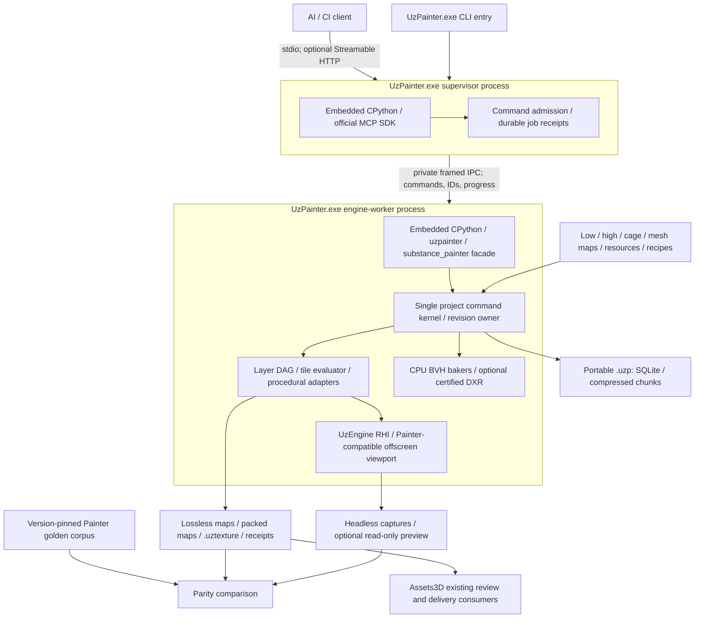

# Astra independent architecture position — round 1

**Fact (owner brief, 2026-10-10; `.rulebook/decisions/001-acceptance-criterion-output-parity-with-substance-painter.md`):** this round requests an independent position before reconciliation and final architecture documents. This is a proposal, not an implementation or a parity certification.

## 0. Executive summary

1. **Recommendation:** ship one Windows executable with two execution roles: a small MCP/CLI supervisor and an isolated native engine worker, both using bundled CPython.
2. **Recommendation:** make one versioned project model and command kernel authoritative for Python, MCP, baking, evaluation, saving and capture.
3. **Recommendation:** preserve the output-affecting Substance API semantics; omit only desktop editing integration, with explicit unsupported errors.
4. **Recommendation:** build a dedicated precision-preserving texture evaluator and Painter-compatible viewport on UzEngine RHI, rather than treating existing engine PBR as the oracle.
5. **Recommendation:** use CPU high-poly baking first and certify DXR acceleration separately; external Blender maps remain first-class inputs.
6. **Recommendation:** store editable state, dependency closure and authoritative raster data in a transactional SQLite project with independently compressed chunks.
7. **Recommendation:** implement exact JSON export semantics, lossless authoring outputs and explicitly described Unreal/glTF/UzEngine derivatives.
8. **Fact (SP2; SP7; AP4; RP findings 3–4):** proprietary procedural dependencies and per-layer resource identity are necessary to reproduce existing assets.
9. **Hypothesis:** an independently calibrated procedural subset can reproduce the selected corpus; general `.sbsar` equivalence is not confirmed.
10. **Fact (AP6; RP findings 1, 5; installed shaders cited in D6):** current Iray/Cycles comparison evidence does not establish identical viewport or Iray output.
11. **Recommendation:** require an owner-selected render reference and a reproducible Painter oracle before claiming replacement; keep zero unexplained divergence as the default gate.
12. **Recommendation:** use approved tunic v10 as the painting pilot, then locked leather/bronze, current hat v8 and the multi-set body; none alone proves complete Painter parity.
13. **Fact (RE; engine files cited in D12):** the inspected engine tree has merge conflicts and a concrete glTF vertex-stride defect. **Recommendation:** establish a resolved, tested pin before integration.

## 1. System context

### Evidence conventions

**Recommendation:** interpret every labelled paragraph, bullet, table row and diagram below as Fact, Hypothesis or Recommendation. Recommendations describe intended behavior, not an existing capability. “Not confirmed” identifies missing evidence; qualitative reversal costs are estimates, not measured schedules.

**Fact (owner-provided filesystem paths):** `P` means `E:/UzmiGames/UzPainter`, `A` means `E:/UzmiGames/Assets3D`, `U` means `E:/UzmiGames/UzEngine`, and `Adobe` means `C:/Program Files/Adobe/Adobe Substance 3D Painter/resources`. Relative project paths resolve under `P`. The following evidence keys resolve to specific files:

| Evidence key | Source path |
|---|---|
| **Fact — SP1** | `P/docs/analysis/substance-parity/01-python-api-inventory.md` |
| **Fact — SP2** | `P/docs/analysis/substance-parity/02-layer-stack-model.md` |
| **Fact — SP3** | `P/docs/analysis/substance-parity/03-baking.md` |
| **Fact — SP4** | `P/docs/analysis/substance-parity/04-export.md` |
| **Fact — SP5** | `P/docs/analysis/substance-parity/05-project-and-spp.md` |
| **Fact — SP6** | `P/docs/analysis/substance-parity/06-mcp-tools-inventory.md` |
| **Fact — SP7** | `P/docs/analysis/substance-parity/07-parity-matrix.md` |
| **Fact — AP1–AP8** | `P/docs/analysis/assets3d-pipeline/01-pipeline-overview.md`; `02-painter-usage.md`; `03-bake-settings.md`; `04-painting-recipes-and-materials.md`; `05-export-and-consumers.md`; `06-review-render-standard.md`; `07-lessons-and-pitfalls.md`; `08-requirements-for-uzpainter.md` |
| **Fact — UE1–UE9** | `P/docs/analysis/uzengine-renderer/01-module-map.md`; `02-headless-rendering.md`; `03-rhi-capabilities-for-texturing.md`; `04-material-and-texture-standard.md`; `05-mesh-import.md`; `06-thirdparty-and-image-io.md`; `07-build-and-packaging.md`; `08-mcp-and-ipc-patterns.md`; `09-gaps-and-risks.md` |
| **Fact — T1–T4** | `P/docs/analysis/technology-options/01-python-embedding-and-packaging.md`; `02-texture-compression-and-containers.md`; `03-project-container-format.md`; `04-mcp-server-options.md` |
| **Fact — RE** | `P/docs/analysis/reviews/uzengine-renderer-astra-review.md` |
| **Fact — RT** | `P/docs/analysis/reviews/technology-options-astra-review.md` |
| **Fact — RP** | `P/docs/analysis/reviews/assets3d-pipeline-astra-review.md` |
| **Fact — RS** | `P/docs/analysis/reviews/substance-parity-astra-review.md` |

**Fact (SP1; AP2; UE1–UE9; T1–T4; RE; RT; RP; RS):** the inspected evidence includes the installed Painter 12.1.0/CPython 3.13.9 inventory, pipeline scripts and saved reports, engine source analyses, technology analyses and all four technical reviews available at the final review check. Historical logs and source inspection are not newly executed application results.

**Recommendation — proposed process and data flow:**

**Recommendation:** the worker owns one open project, its resource graph, evaluation revision and GPU state. The supervisor never maintains a second editable copy. Its job journal is separate from the project database; the worker alone commits project state. Large raster payloads travel through artifact references or bounded shared buffers, not routine JSON/base64 responses.

**Recommendation:** the public execution sequence remains create/open → import or bake mesh maps → edit the stack → evaluate → export/save/capture. `sync` is a convenience adapter for the existing Assets3D recipe, not a second mandatory workflow. Python scripts execute in the worker against the same kernel as typed commands. No human layer, material, painting or UV editor is introduced.

**Fact (AP1; AP5–AP8; RP findings 2, 12, 15):** Assets3D has external geometry, UV, fidelity, visual-review and delivery gates. The replacement request authorizes UzPainter work; historical Painter-only wording does not require renewed permission for this proposal. **Recommendation:** preserve those gate boundaries and approval provenance during adoption, while making native bake and requested exports mandatory UzPainter capabilities.

## 2. Decisions D1–D14

### D1. Execution topology

#### Options considered

**Recommendation:** consider (a) one C++ process embedding engine, CPython and MCP, (b) a Python host loading an engine DLL, and (c) one distributed executable with supervisor/worker process roles. Prefer (c); avoid a user-managed Python environment and avoid a handwritten C++ MCP stack.

#### Position

**Recommendation:** `UzPainter.exe --mcp` embeds the official Python SDK and launches the same executable as a non-visible engine worker. The worker links selected UzEngine components and embeds the scripting interpreter. CLI batch operation uses the same supervisor/kernel contract. Start with one worker/project per instance; distinct instances can process independent projects.

**Recommendation:** use a conventional GIL-enabled CPython build compatible with the recorded 3.13.9 oracle, isolated `PyConfig` paths and a pinned embedding binding such as pybind11. Give the worker a Python command/event thread, a render/RHI submission thread and bounded native job pools. Native CPU work and fence waits release the GIL explicitly; Python callbacks acquire it on the Python thread. Neither MCP I/O nor render submission waits while holding the GIL for a long native job.

**Recommendation:** serialize document mutation admission and commits. Jobs compute against immutable input revisions; export/capture identify the evaluated revision. Contain native faults/device removal in the worker. After a worker death, keep MCP responsive, reconcile the last durable commit, report interrupted/unknown outcomes honestly, and recover a checkpoint. Never silently replay a non-idempotent mutation.

#### Rationale

**Fact (SP5; SP6; AP7; RP INT-04/NFR-06; RT findings 1–6, 28):** public operations include busy/asynchronous state, and the pipeline records crashes and stale operation outcomes. GIL release enables native parallel work but does not isolate native memory faults. **Fact ([CPython Windows embedding documentation](https://docs.python.org/3.13/using/windows.html#the-embeddable-package)):** the embeddable distribution supports private application packaging with vendored dependencies. **Recommendation:** the process boundary is justified by recovery, not by a need for several editable application states.

#### Risks

**Hypothesis:** duplicated interpreter/runtime overhead and IPC ordering can outweigh isolation for small jobs; measurements are not confirmed. **Recommendation:** use a versioned internal protocol, project/revision preconditions and a Windows process-lifetime policy so a lost supervisor does not leave an uncontrolled writer. Process isolation is fault containment, not an arbitrary-Python security sandbox.

#### Cost to reverse

**Hypothesis:** moderate if the command kernel and native/Python boundary remain independent of IPC; high if Python object identities or GPU handles leak into transport contracts. A later in-process mode can reuse the kernel without changing project files.

### D2. v1 API scope

#### Options considered

**Recommendation:** consider a fills-only pipeline facade, an indiscriminate copy of every public symbol, or an inventory-driven output-compatible facade. Choose the third; early fills-only milestones must not be labelled complete v1.

#### Position

**Recommendation:** retain output-related surfaces in `project`, `textureset`, `layerstack`, `source`, `resource`, `properties`, `levels`, `baking`, `export`, `colormanagement`, `event`, `async_utils`, `exception` and `logging`. Retain `application` version/state/close and computation-status/toggle/context-manager calls; retain all `display` environment/LUT/tone-mapping/camera symbols. Preserve active texture set/stack and layer selection as script context even without a GUI. Preserve enum spellings, argument defaults, channel interpretation and errors through a symbol-level capability manifest derived from SP1 plus RS's inherited-member corrections.

**Recommendation:** classify every inventoried symbol as supported, desktop-only omitted, or output-affecting release gap. The last category blocks the affected parity claim; it is not silently removed from the product requirement. Full v1 covers all output-affecting inventoried capabilities and the required AI extensions, not just the calls observed in one asset.

**Recommendation:** omit Qt window/widget access, dock/menu/toolbar creation, layout and focus management, editing widgets and desktop plugin presentation. Provide script-module loading where plugin lifecycle has output-related use. Raise a typed unsupported-feature error instead of pretending omitted calls succeeded. The omission rule is dependency-based: an omitted symbol must not change a supported texture, render or script result; an instruction using it must either be presentation-only or have an explicit equivalent.

**Recommendation:** specifically omit `ui.show_main_window`, `get_main_window`, `get_layout`, `get_layout_mode`, `set_layout`, `reset_layout`, `add_dock_widget`, `add_plugins_toolbar_widget`, `add_menu`, `add_toolbar`, `add_action` and `delete_ui_element`. Keep `UIMode`/`ApplicationMenu` identifiers importable if useful to compatibility, without Qt objects. Treat `get_current_mode`/`switch_to_mode` as logical mode compatibility only after checking their output/readiness consequences; suppressing evaluation in a visualisation mode cannot be silently ignored. Preserve non-UI `substance_painter_plugins` discovery/start/stop/reload behavior through the script loader. Imports or plugin startup must not require a human editor.

**Recommendation:** retain verified output-affecting `js` uses through a documented compatibility subset and native typed equivalents for shader/display state. Do not claim a generic `alg.*` JavaScript runtime. Public Python gaps such as stroke authoring and capture require explicit `uzpainter` extensions, not their removal from AI-operated Painter functionality.

#### Rationale

**Fact (SP1; RS coverage ledger/F11):** SP1 inventories 18 package submodules plus the separate plugin module; its 572 physical rows are not 572 unique public symbols. RS counts 545 installed documented anchors and identifies inherited `UVTile.u`, `UVTile.v`, `TextureSet.material_id` and two constructor omissions, plus private-helper classification corrections. **Recommendation:** include those public members, exclude private mixins from the supported-public denominator and report coverage by qualified symbol/class/context/operation. **Fact (SP1; SP2; SP5; SP7):** API visibility does not imply public implementations of painting strokes, shader control or viewport capture; wrappers rely on private native Painter functionality. **Fact (AP2; `A/Docs/Pipeline/Pintura/painter_layer_stack.py`):** active-stack context and ordered channel/source writes are used by real scripts.

#### Risks

**Hypothesis:** undocumented defaults, aliases and script-visible side effects are a larger compatibility risk than missing function names. **Recommendation:** maintain separate compatibility behavior and improved native behavior; do not silently “fix” a Painter quirk in the compatibility namespace when it can change subsequent output. The pipeline review's requested safer channel toggling is appropriate for the native API; facade behavior needs oracle verification.

#### Cost to reverse

**Hypothesis:** low for adding missing wrappers; high for changing already-persisted defaults or channel semantics. Keep the compatibility profile versioned in each project.

### D3. Layer stack and composition

#### Options considered

**Recommendation:** consider reusing the engine material graph as the document, a flattened raster stack, or a dedicated Painter-semantic document evaluated through engine compute/raster facilities. Choose the dedicated document.

#### Position

**Recommendation:** model project → material-named texture sets → stacks/channels/UV tiles → ordered layers with separate content and mask effect lists. Store stable native node IDs, duplicate-capable names, visibility, per-channel enabled state/blend/opacity, typed sources, projections, effective defaults and immutable resource bindings. Expose compatibility UIDs with checked lifetimes; stale handles fail. Store order explicitly and test API top-first order against bottom-to-top evaluation.

**Fact (RS F12/F13/F20):** Painter documents internal integer UIDs/invalidation, not universal persistence across reload/undo; layered stacks require explicit addressing, and legacy/OpenPBR alias names do not establish every native enum equality. **Recommendation:** make native stable identity a new guarantee, resolve compatible handles afresh after lifecycle changes, address layered stacks by texture-set/stack identity and calibrate aliases/defaults instead of guessing them. Preserve material-layering channel restrictions and synchronized instance content while allowing independently documented instance properties.

**Recommendation:** represent all twelve documented node kinds: PaintLayer, PaintEffect, FillLayer, FillEffect, GeneratorEffect, FilterEffect, LevelsEffect, CompareMaskEffect, ColorSelectionEffect, GroupLayer, InstanceLayer and AnchorPointEffect. Smart materials expand into editable groups; smart masks expand into effects. Keep content/mask insertion constraints, mono mask blending, geometry Mesh/UVTile masks, instance references and an acyclic anchor dependency graph with channel/alpha/levels transforms.

**Recommendation:** specify capabilities per node class and content/mask context. Mask Fill uses `None` channel/source-mode handling; it is not a third `SourceMode` enum member. Mask blend/opacity requires `None`, while a channel is required in multichannel contexts. Reject Python-only attributes that masquerade as native writes; support source reset/removal and Generator/Filter main-resource replacement separately from parameter edits. Bitmap color-space operations, vector/font parameters and HDR/raw colors require their own contracts, not a generic resource-binding claim.

**Recommendation:** implement the complete documented blend-mode set: Normal, PassThrough, Disable, Replace, Multiply, Divide, InverseDivide, Darken, Lighten, LinearDodge, Subtract, InverseSubtract, Difference, Exclusion, SignedAddition, Overlay, Screen, LinearBurn, ColorBurn, ColorDodge, SoftLight, HardLight, VividLight, LinearLight, PinLight, Tint, Saturation, Color, Value, NormalMapCombine, NormalMapDetail and NormalMapInverseDetail. Calibrate alpha/matte handling, signed Height, clamping and group isolation per channel; mode names alone are not formulas.

**Recommendation:** support Split/Material/mono-mask sources, uniform/bitmap/procedural/vector/font/anchor inputs, all documented projection modes and sampler/wrap/physical-scale settings. Keep UV-tile workflow and per-tile resolutions first-class; do not confuse UDIM tiles with extra UV attribute streams. Preserve authoritative raster tiles and AI stroke descriptions for paint content; precise brush/particle semantics are separate certification obligations.

**Recommendation:** execute an incrementally invalidated DAG by tile/channel with finite memory admission, explicit border support and precision chosen by channel format. Preserve 16-bit integer authoring values through integer or sufficiently precise float paths; FP16 is not an automatic replacement for UNORM16. Quantization and color transforms occur at defined boundaries, not incidental cooker stages.

#### Rationale

**Fact (SP2):** the node, blend, projection, channel-format, anchor and insertion inventories establish exposed structure; they do not provide complete compositor equations. **Fact (UE3; RE F06):** the existing GPU material baker is an RGBA8/fixed-output facility, not a demonstrated Painter compositor. **Fact (RP findings 4, 7; `A/Creatures/Undead/Skeletal Mage/Models3D/18-Tunica/report.json` → `painting_v10.source_recovery`):** C07 and F03 require different historical piping-mask resources.

**Recommendation:** obtain reference equations from available Adobe API/shader documentation and permitted technical references, then establish executable truth using controlled Painter basis textures, isolated layers/groups and intermediate exports. Bind tunic C07 to its v10 source and F03 to its v9 source through per-node hashes/explicit migration aliases; never replace all resources sharing `M_piping` globally.

#### Risks

**Hypothesis:** matte behavior, color-space conversions, sampling footprints, height-to-normal conversion and tile-border filtering can defeat equality even when the tree matches. Warp-grid and brush/particle internals are not fully exposed in SP1/SP2; complete reproducibility is not confirmed. **Recommendation:** reject unsupported evaluation rather than flattening invisibly or substituting a generic effect.

#### Cost to reverse

**Hypothesis:** high for order, alpha and precision conventions; moderate for evaluator kernels behind a stable typed document. Version kernels and migrate state explicitly.

### D4. Proprietary procedural content

#### Options considered

**Recommendation:** compare a lawfully distributable Substance runtime adapter, independent HLSL implementations of named resources, a generic procedural library, frozen raster outputs and a permanent installed-Painter service. Reject the service as the standalone replacement and generic look-alikes as parity evidence. Treat runtime availability as unconfirmed, not an assumed SDK entitlement.

#### Position

**Recommendation:** create a procedural backend interface and pursue an independently implemented, precisely identified HLSL subset for the migration corpus. Its first required dependencies include Mask Builder Legacy, Mask Editor, Metal Edge Wear, Dirt and Sharpen; used felt/leather/burlap sources; Leather Damaged, Bronze Armor and the recorded forged-iron recipe; and their transitive grunge/mesh-map/anchor inputs. Freeze actual resource IDs, bytes or retrievable provenance, revisions, parameters, seeds and inputs from AP4/RP before assigning “supported” status.

**Recommendation:** certify each resource over the meshes, resolutions, UV modes, parameter values and parameter variations required by the frozen workflows. Parity means equal native channel outputs from equal effective inputs, not similar material appearance. A validated closed corpus is a bounded milestone; it does not establish arbitrary-parameter or arbitrary-`.sbsar` equivalence.

**Recommendation:** accept a licensed runtime backend only if technical embedding, runtime version pinning and standalone distribution rights are established. Preserve the adapter seam so it can replace independent kernels. Until one backend reproduces every required dependency, full procedural parity remains blocked. Frozen outputs can preserve an old approved snapshot, but cannot certify editable reevaluation after a mesh, seed or parameter change.

#### Rationale

**Fact (SP2; SP7; AP4; RP finding 3 and MAT-02–04):** shipped generators/filters/materials rely on proprietary `.sbsar` evaluation, and locked/current leather/bronze and historical hat recipes use them. Names and captured parameters are not their implementation. **Fact (UE1–UE9):** no equivalent Substance runtime integration is established in the engine analysis. **Hypothesis:** calibration can recover exact behavior for some resources; feasibility across all required dependencies is not confirmed.

#### Risks

**Hypothesis:** hidden algorithms, engine-specific noise, precision, sampling and inaccessible dependencies can make exact reproduction impractical. **Recommendation:** stop a release claim on that evidence; an owner-approved art/recipe migration is a changed acceptance scope, not retroactive parity. Source availability and permission to redistribute Adobe content are distinct questions; neither is inferred from installation access.

#### Cost to reverse

**Hypothesis:** low for switching a well-defined backend, high for reproducing many proprietary graphs independently or adopting a new art corpus. Preserve exact input/output schemas and dependency identities.

### D5. Bake

#### Options considered

**Recommendation:** compare DXR-only baking, CPU BVH-only baking and a common baker contract with both backends. Choose both, with CPU as the first reference/debug implementation and DXR as a separately certified accelerator. Do not make DXR hardware a requirement for importing maps or ordinary stack operations.

#### Position

**Recommendation:** provide all ten `MeshMapUsage` bakers: Normal, WorldSpaceNormal, ID, AO, Curvature, Position, Thickness, Height, BentNormals and Opacity. Ingest unsimplified high-poly and explicit cage geometry directly; preserve source attributes needed by ID/opacity and normal sampling. Match common, per-set, per-baker and linked-group settings and enablement.

| Parameter family | Mapping and implementation position |
|---|---|
| **Fact (SP3) — confirmed Python keys** | `OutputSize` is a log2 pair; `HipolyMesh` accepts pipe-joined file URLs; `LowAsHigh`, `CageMode`, `CageMesh`, `SubSampling`, `DilationWidth`, `Distribution`, `NbSecondary` and `AutoMinMax` are observed keys. The custom-cage test pairs `CageMode=2` with `CageMesh`; other numeric enum meanings must not be guessed. |
| **Recommendation — common/detail compatibility** | Expose the oracle-discovered Property descriptors and map effective front/rear distances, relative scale, averaged/smoothed normals, backface/skew behavior, match mode, suffixes, UV selection, AA, dilation/diffusion and output formats. Capture metadata/defaults from the exact Painter build. |
| **Fact (SP3) — serialized identifiers** | `Detail.MaxHeight`, `MaxDepth`, `RelativeScale`, `SmoothNormals`, `FilterMethod`, `LowpolySuffix`, `HipolySuffix` and secondary-ray identifiers appear in evidence; SP3 marks several general Python-key/enum correspondences as not confirmed. |
| **Recommendation — AO/BentNormals** | Map secondary-ray count, distance bounds/relative scaling, spread, distribution, backface/self-occlusion, AO attenuation and ground-plane settings to confirmed Property names. Preserve sample sequence/backend provenance. |
| **Recommendation — Curvature/Position/Thickness/Height** | Preserve curvature sampling radius and effective automatic/fixed bounds; position mode/axis/normalization/scale; thickness range normalization; height normalization/divisor. Saved “automatic” settings are insufficient when an effective fixed-bound result was used. |
| **Recommendation — Normal/WorldSpaceNormal/ID/Opacity** | Preserve tangent convention and per-fragment calculation, ID source/color policy, opacity source/threshold semantics and normal/skew/cage settings, with exact descriptors and outputs verified against SP3 goldens. |

**Recommendation:** support distance-based and file cages and match-by-name/suffixes without topology modification. Implement AA as explicit coverage/sample accumulation matching the reference, not an inferred MSAA enum. Keep automatic cage support as an output-affecting gap until its behavior is established; do not label a different cage algorithm compatible. Select DXR dispatch requirements per implementation: current Tier 1.0 support checks do not certify inline RayQuery.

**Fact (RS F05; V25–V29):** old saved suffix/sample/normalization values and documentation examples do not prove Painter 12.1 initialization defaults. **Recommendation:** keep those as fixture inputs, and capture current Property defaults/types/ranges/enum values and linked-set propagation independently. Transactional native bake-setting changes must cover every affected linked set; community best-effort rollback is not the guarantee proposed here.

**Recommendation:** import external Blender geometry-only OpenGL Normal and AO losslessly into named mesh-map slots, retain their original bytes/provenance and normalization, and let generators bind exact usages. Native high-poly bake remains a v1 requirement despite this compatibility path. Never replace a high-derived map with a low-derived approximation silently.

**Recommendation:** expose bake jobs with stop/cancel, current job ID and the compatible `BakingProcessAboutToStart`, progress and ended events. Publish all maps atomically for their input revision or report failure/cancellation without a partial authoritative bake. Provide auxiliary straight/cage hits, center/conservative coverage, misses, extensions, hidden-flat/fallback and padding-change diagnostics; these do not alter the compatible maps.

#### Rationale

**Fact (SP3; AP3; RP findings 2, 6–9; RE F04):** source selection, cages, dynamic Properties and asynchronous events exist; pipeline evidence distinguishes actual ray/coverage stages, and the engine's ray-tracing Boolean does not prove RayQuery capability. **Fact ([Adobe 12.0 release notes](https://experienceleague.adobe.com/en/docs/substance-3d-painter/using/release-notes/version-12-0)):** Adobe records CPU/GPU AO differences. **Recommendation:** record the oracle's bake backend rather than treating “Painter AO” as one unqualified algorithm.

#### Risks

**Hypothesis:** matching BVH intersections alone will not reproduce AO/curvature normalization, stochastic sampling, cage generation or edge coverage. CPU/DXR pixel equality and performance are not confirmed. **Recommendation:** distinguish low AO from actual misses; retain the recorded pipeline AO-count inconsistency as unresolved evidence rather than turning it into a golden expected count. Do not repair valid used-surface normals just to satisfy a display threshold.

#### Cost to reverse

**Hypothesis:** moderate for backend selection with a shared sample contract; high for changing ray/coverage/normalization semantics after assets depend on them. Persist effective settings and implementation versions.

### D6. Preview and render parity

#### Options considered

**Recommendation:** compare UzEngine's fixed PBR renderer, a dedicated Painter-compatible GLSL-to-HLSL viewport path on engine RHI, and Iray reproduction. Choose the dedicated viewport path for the proposed feasible render reference; keep native engine PBR as a consumer test. Do not assert Iray equivalence.

#### Position

**Recommendation:** implement an offscreen viewport whose shader selection, material channel interpretation, normal/Height conversion, sampling, IBL integration and display transform follow the actual pinned Painter viewport. Port permitted shader behavior to HLSL and reproduce its supporting libraries, sparse-texture semantics, BRDF/LUT/IBL data and final composition. Shader text alone is insufficient.

**Fact (direct read of `Adobe/starter_assets/shaders/pbr-metal-rough.glsl` and `open-pbr.glsl`):** both GLSL entry shaders exist. [Redacted under the clean-room policy (docs/licensing-and-clean-room.md). Source withheld: Adobe/starter_assets/shaders/pbr-metal-rough.glsl; Adobe/starter_assets/shaders/open-pbr.glsl.] Their inspected SHA-256 values are respectively `A434A2B28184C3D1CDB0E9EC602DFEFA961D75C07B1E9AFB7964F29FBE2AEF47` and `327CE488F5A13ACE09479081F454EDD4FA536AB8DE4D03504293378CC9F5655E`.

**Fact (direct file inventory under `Adobe/shader-doc/`):** supporting `lib-pbr.html`, `lib-pbr-specular.html` and `lib-normal.html` documentation exists; the inspected library-name search did not establish loose files for every imported `.glsl` library. Redistribution/derivative permissions are not confirmed by these reads. **Recommendation:** resolve permitted implementation/distribution before shipping translated Adobe source; source access is evidence, not automatic permission.

**Recommendation:** propose the real-time Painter viewport, not Iray, as the explicit product render reference for owner ratification. Record the actual shader ID/hash instead of inferring it from channel names. Fix camera matrices/FOV/clipping and coordinate conversions; HDRI bytes/hash, environment orientation/intensity; shader parameters; resolution; sample/AA state; exposure; shadows/background; OCIO config/hash, display/view/look and tone mapper; post effects; deterministic frame/history policy. Disable incidental engine exposure/TAA/post only where the oracle is also configured that way.

**Recommendation:** define the initial neutral viewport fixture at the pipeline's 1200×1200 comparison size, using the installed `Studio White Soft.exr` with verified bytes/hash, environment rotation/exposure zero, no ground/shadows, a constant RGB89 background, and the exact recorded reference camera transformed into the engine basis. Set `ToneMappingFunction.Linear` explicitly in both applications, use the pinned `ocio/substance/config.ocio` and the recorded Default/sRGB display state, and record the actual viewport shader/quality and every additional effect. These are proposed fixture settings; the existing Iray standard does not prove that its viewport or tone-mapping state already matches them. Required owner ratification and repeatable actual-state capture precede render acceptance.

**Recommendation:** reuse the Assets3D reference environment and framing where their actual Painter state can be verified. Do not equate the existing `ref_match` label with a validated Painter viewport configuration. Include shader/display state in project recovery and expose typed apply/readback/capture APIs. A capture waits for evaluation, resources and GPU fences and returns its project/evaluated revision and applied render-state digest. The optional read-only viewer consumes that state without pausing work.

#### Rationale

**Fact (AP6; RP R05–R07; `A/Docs/Pipeline/Render/Render-Comparison-Standard.json`):** the pipeline compares Iray/Cycles approximately; the Painter `ref_match` equivalent is not live-verified. **Fact (UE2; RE source ledger C05/C08 and F08):** existing hidden rendering uses a window/swapchain, a null-swapchain scene call renders nothing, and diagnostic readback is not arbitrary-precision export. **Recommendation:** implement explicit offscreen scene targets and native readback, including linear and display-referred captures.

#### Risks

**Hypothesis:** missing Painter host shading libraries, environment prefiltering and compiler/hardware numerical behavior can prevent exact viewport equality. **Recommendation:** if the owner means the pipeline's Iray renders, the proposed viewport path does not meet that requirement; keep render-parity acceptance blocked until a feasible agreed reference or another demonstrated implementation exists. Existing Blender/Cycles gates remain useful pipeline QA but do not resolve this blocker.

#### Cost to reverse

**Hypothesis:** high when switching viewport/Iray/native-engine reference after calibration; moderate for adding another renderer behind a recorded render-state contract. Decide the reference before shader implementation.

### D7. Export

#### Options considered

**Recommendation:** compare filename-oriented engine cooking, a new export schema, and Painter-compatible JSON compiled into a typed export plan. Choose the third, with separate encoding/compression backends.

#### Position

**Recommendation:** support `exportPath`, `defaultExportPreset`, `exportPresets`, `exportList`, ordered `exportParameters` and `exportShaderParams`, preserving map/channel source selectors, rootPath/filter/outputMaps/UVTile selection, sizeLog2 behavior, filenames and override precedence. Preserve `{}` versus an explicitly empty selection. Parse and validate before GPU work; expose the resolved output plan so an AI can inspect it.

**Recommendation:** preserve per-root `exportPreset` selection, explicit TextureSet/Stack paths, filename tokens `$project`, `$mesh`, `$textureSet`, `$sceneMaterial`, `$udim`, `$uvTileName` and `$colorSpace`, and document/mesh/virtual/constant source families including Glossiness and f0. **Fact (RS F06/F19; U02):** decoded preset boundaries do not establish all numeric semantics, and the exact predefined Painter glTF map list is not confirmed by the inspected files. **Recommendation:** distinguish a standards-compliant glTF target from a certified mirror of Painter's dynamic preset; capture the latter before advertising preset equality. Enumerate exact format/depth/dither combinations rather than inferring enabled dithering from tests with dithering disabled.

**Recommendation:** make inline Assets3D PNG16 export and PBR Metal Rough, Unreal packed ORM and glTF presets mandatory. Translate the 34 decoded `.spexp` presets through verified source/channel semantics; do not infer unconfirmed numeric preset encodings. Advertise supported encoders explicitly; remaining output-affecting formats stay visible release gaps until implemented.

**Recommendation:** compute virtual normal output with geometry Normal plus authored Normal/Height exactly once, and provide geometry-only diagnostics separately. Use the verified `AO_Mixed` virtual-map identifier; reject an unknown source such as `Mixed_AO` before dispatch. Preserve PNG16 quantization, non-square size semantics, all padding modes (`passthrough`, `color`, `transparent`, `diffusion`, `infinite`) and explicit dithering. Match tie-breaking, edge coverage, diffusion and seeded dither against the oracle.

**Recommendation:** Unreal ORM uses linear R=AO, G=Roughness, B=Metallic with its explicitly chosen normal convention, ordinarily the preset's DirectX normal. glTF uses its verified normal convention and linear occlusion R/roughness G/metallic B; sharing one ORM image does not require a packing extension. Preserve Opacity and SpecularWeight in the export plan; do not drop them merely because an older five-map script omitted them.

**Recommendation:** generate `.uztexture` directly from explicitly described source channels: BC7 sRGB BaseColor with opacity in alpha; BC5 linear normal RG; BC7 linear packed ORM or declared BC4 scalar alternatives; BC7 sRGB LDR emission where applicable. Generate color mips in the correct space, normal mips with the selected normal policy and opacity-aware mips where required. Avoid the existing filename classifier and forced-RGBA8 path as the authoring source of truth.

**Recommendation:** retain PNG16/float authoring sidecars for Height, Thickness and other data where the selected `.uztexture` consumer cannot preserve their precision or semantics. A negative-Z normal cannot be represented by a positive-Z reconstruction contract without information loss: reject that runtime target or use an explicitly supported extended route. Bind SpecularWeight and material flags through a tested material adapter; any absent engine channel binding is reported as a consumer gap, not as successful export.

**Recommendation:** use a pinned deterministic CPU BC encoder available in the inspected dependency set, with an adapter allowing later replacement after output tests. Treat BC textures as lossy runtime derivatives, never as lossless project/authoring data. Unreal import/cook behavior must be validated for the selected engine version; compressed handoff is not assumed to bypass engine cooking. Stage outputs, verify format/dimensions/flags/mips/payload sizes and hashes, then publish a complete manifest atomically.

#### Rationale

**Fact (SP4; AP5; RP findings 5, 13–14; UE4; RE F05/F07/F09/F10/F12/F17):** export schema/presets and PNG16 pipeline usage are documented; engine ORM/RG normal conventions exist, while opacity sampling, Height/Thickness classification, color interpretation and precision have route-specific hazards. `PngCodec::EncodeMemory` accepts 16 bits, but `EncodeFile` hardcodes 8. **Recommendation:** use precision-preserving readback plus the verified memory encoder/file publication path, with bounded queue ownership and fence/pitch handling.

#### Risks

**Hypothesis:** virtual-map composition, padding, conversion and lossy compression can each introduce divergence. **Fact (RP finding 5; `A/Docs/Pipeline/Retopologia/chapeu-v6/deliver_v8.py`):** a recorded Blender SpecularWeight handoff is not fully implemented by the checked commented link. **Recommendation:** validate saved consumer materials, not reports or suffixes alone; record compression error separately from Painter-authoring equality.

#### Cost to reverse

**Hypothesis:** low for encoder/preset adapters; high for persisted normal/channel/space interpretations or wrong exported consumer assumptions. Version both source and runtime-target contracts.

### D8. Project format

#### Options considered

**Recommendation:** compare HDF5, ZIP plus compressed chunks, SQLite plus compressed BLOBs and a new bespoke chunk container. Choose SQLite for a single portable `.uzp` file at rest; use Zstandard per independently addressable payload, not a compressed monolithic database.

#### Position

**Recommendation:** store a versioned canonical JSON document, typed nodes/defaults, immutable content-hashed source resources and per-node bindings, raster/stroke data, mesh/cage/map/HDRI dependency closure, color/render state, evaluator versions/seeds and committed revisions. Store sufficient source mesh attributes and provenance to reproduce import/bake; do not depend on the original absolute path being present. Portable mode embeds required dependency bytes; an explicitly nonportable mode may use verified locators and must report missing dependencies.

**Recommendation:** retain every authoritative raster plane and imported resource at native precision. Recomputable evaluation/mip/preview caches are optional and carry input/implementation digests; unknown procedural outputs needed to preserve a snapshot are authoritative until proven recomputable. Recipe-only saving is insufficient for paint strokes, unavailable resources and unproved procedural reevaluation. Deduplicate identical bytes without merging semantically different bindings or color interpretations.

**Recommendation:** implement incremental saves by inserting changed immutable chunks and committing a new document revision transactionally. Keep the current and previous completed checkpoint explicitly addressable, with bounded retained history. Use rollback-journal transactions for the initial portable implementation; no uncheckpointed WAL is mistaken for a complete project. Full save produces a compact verified replacement snapshot and then atomically publishes it; inspection/export reads a committed revision, not mutable job buffers.

**Recommendation:** provide Python/MCP/CLI inspection of schema version, tree, dependencies, effective settings, digest, compressed/uncompressed payload totals and retained cache/history costs. Include per-chunk length/checksum validation, transaction recovery and explicit incompatible-version errors. Corruption detection does not promise reconstruction of missing content. Migrations are explicit and preserve the original project as an artifact.

**Fact (SP5; AP2; `A/Creatures/Undead/Skeletal Mage/Models3D/00-Corpo/report.json`; RP NFR-04):** observed body `.spp` sizes include 879,248,615, 1,087,438,533 and 1,190,431,812 bytes. The analyses do not establish how much is irreducible source/raster payload or recoverable cache/history. HDF5 signatures alone do not explain the sizes.

**Recommendation:** set the compact-save budget from a measured lossless dependency/authoritative-plane census plus document/index and explicitly retained checkpoint overhead; disposable caches must not dominate the portable save. Compare against a semantically equivalent compacted `.spp`, report the size ratio and require a substantial measured reduction on the body corpus. A defensible numeric “much smaller” threshold and feasibility are **not confirmed**; ratify them after the census, before format acceptance. Do not promise an invented megabyte target or obtain a ratio by removing editability.

**Recommendation:** report project-file size and external dependency-closure size separately for both formats. Compare matched embedding/history policies; adding a portable high-poly/HDRI dependency to only one side or excluding necessary linked inputs from only one denominator makes the ratio misleading. Preserve the measured old `.spp` comparison as historical evidence alongside the matched compact-save benchmark.

#### Rationale

**Fact (T3; RT findings 20–23; [SQLite application-file guidance](https://sqlite.org/whentouse.html); [SQLite WAL documentation](https://sqlite.org/wal.html)):** SQLite is an application-file option with transactions and one writer; WAL has companion state and SQLite does not itself compress raster BLOBs. **Recommendation:** its transaction/inspection model fits AI-driven revisions; explicit payload compression and compact-save policy address size separately.

#### Risks

**Hypothesis:** incompressible unique masks/high-poly inputs and retained authoritative planes may limit reduction more than container choice. Compression, journaling and full-save temporary disk/memory costs are not measured. **Recommendation:** never store BC7/BC5 as an irreversible substitute for editable lossless inputs, and test interruption/disk-full/save-copy semantics.

#### Cost to reverse

**Hypothesis:** moderate while the canonical document/chunk schema is storage-independent; high after unversioned SQL details become public APIs. Expose inspection through the application, while retaining ordinary SQLite readability.

### D9. Python API shape

#### Options considered

**Recommendation:** compare a new package only, a replacement `substance_painter` only, and a native package plus a versioned compatibility namespace. Choose `uzpainter` with a bundled `substance_painter` facade.

#### Position

**Recommendation:** run existing create/stack/export scripts inside the worker with unchanged imports where their supported public calls permit it. Add a small transport/launcher adapter in the pipeline rather than rewriting recipes into another process. Changes involving `.spp` paths, private capture calls, output-affecting JS and tunic-specific recovered resources remain explicit migration changes; “minimal change” is not a claim that every historical script already runs unchanged.

**Recommendation:** preserve signatures, enums, typed Property descriptors, source objects, result/status conventions, metadata, busy/readiness state, node lifetime and event ordering. `ProjectOpened` alone must not be treated as edition/evaluation readiness. Preserve Full/Incremental/copy save semantics and dirty/path effects separately. In the native API, expose explicit project/revision handles, transactions, jobs, render-state/capture, paint strokes and richer diagnostics without hidden UI state.

**Recommendation:** native long operations return awaitable/pollable jobs. Compatibility functions retain their documented synchronous or asynchronous behavior, including ready callbacks/events. Dispatch callbacks on the worker Python event thread after committed state transitions; a blocking facade wait pumps the required event machinery without blocking GPU or native workers.

**Recommendation:** expose typed errors with operation, project/revision, job and affected path/node details. Match compatible exceptions where documented; do not convert failures into successful `{}` or swallow tracebacks. Export function exceptions remain distinct from event statuses. CLI fails with nonzero exit, Python raises, and MCP emits a structured tool failure according to its pinned schema. Trusted `execute_python` captures result, stdout and stderr separately and never interprets process exit alone as script success.

**Recommendation:** validate every supported mutation against freshly resolved native-backed state; require persisted/output comparison where relevant. A wrapper's echoed argument or arbitrary Python attribute is not readback. Preserve callback lifetimes for mesh reload separately from event-dispatch completion for creation/bake/resource operations, and distinguish command admission, commit, resource readiness and completed evaluation.

#### Rationale

**Fact (SP1; SP4–SP6; AP2; AP7; RP INT-01/INT-02/QG-03):** current scripts use the public namespace, synchronous export and asynchronous project/reload/bake behavior; the historical bridge has result/print and concealed-error pitfalls. **Recommendation:** keep compatibility in a facade over the kernel, not a second evaluator or private `_substance_painter` reimplementation.

#### Risks

**Hypothesis:** facade event reentrancy, stale IDs and legacy cache/session behavior can create false success or changed output. **Recommendation:** default public external-client access to typed command proxies; only trusted scripts execute arbitrary Python in the worker. CPU/GPU operation remains native despite Python orchestration.

#### Cost to reverse

**Hypothesis:** low for facade wrappers; high for changes to error/event/readiness behavior after pipeline adoption. Pin the facade profile with golden script tests.

### D10. MCP server

#### Options considered

**Recommendation:** compare official Python SDK embedded in the executable, handwritten C++ MCP and a separate user-installed bridge. Choose the official SDK in the supervisor's embedded interpreter; its only internal bridge is private worker IPC, not Painter's remote HTTP API.

#### Position

**Recommendation:** make stdio the default AI/CI transport; stdout contains only protocol data, with logs on stderr/artifacts. Offer Streamable HTTP for an explicitly configured resident service, loopback by default, with authentication/origin policy for network use. Both transports call the same kernel contract and capability registry.

**Recommendation:** publish typed tools for project, resources, texture sets, stack/effects, baking, exports, render state and jobs, with API-matching concepts and compact parameter schemas. Offer existing workflow recipes such as `sync` and batch execution as transparent transactions over those tools. Return changed/skipped/imported/written items, precondition/evaluated revision, warnings and artifact references. Let discovery/inspection explain capabilities and missing output-affecting features.

**Fact (RS F01–F04/F07/F09/F10):** existing community routes can falsely succeed for Paint active-channel writes, fail in mono-mask source/blend contexts, perform partial mutations before failure, misprobe bake-preset support and omit bitmap-space operations; their snapshots/cleanup do not establish semantic equivalence/atomicity. **Recommendation:** mirror the public operation semantics rather than those defects; split discovery into native symbol presence, named route support and verified runtime behavior. Advertise atomic native transactions as a deliberate new guarantee and test rollback/readback failure across linked sets. Raw Python availability does not count as a verified named tool.

**Recommendation:** use durable native job IDs and `job_status`, `job_result`, `job_cancel` tools as the first universally usable long-job contract. Add an MCP Tasks adapter only after a selected SDK/client pair demonstrably supports the current extension. Link task/job IDs and durable receipts; never return a Tasks result to a client that did not negotiate it.

**Fact ([MCP specification](https://modelcontextprotocol.io/specification/2026-07-28); [Tasks extension](https://modelcontextprotocol.io/extensions/tasks/overview)):** revision 2026-07-28 is current in the checked official landing page; Tasks is optional and negotiated, using durable handles and polling. **Fact ([official Python SDK migration guide](https://py.sdk.modelcontextprotocol.io/migration/#experimental-tasks-support-removed)):** its checked v2 documentation says the redesigned Tasks extension is not implemented yet. **Recommendation:** pin an actual released SDK and protocol/client conformance matrix; documentation for `MCPServer` versus v1 `FastMCP` does not establish the release used by UzPainter.

**Recommendation:** grant one mutation lease per project, not one global lock across independent instances. A conflicting write returns busy/conflict with the active job ID; reads use committed snapshots, and captures/export require coherent evaluation. Include idempotency keys and revision preconditions so AI retries do not duplicate mutations. Cancellation acknowledges intent, while the final receipt reports whether work actually stopped or committed.

**Recommendation:** enforce independent allowlists for projects, low/high/cage meshes, resources and exports; canonicalize Windows paths and validate final targets, including reparse points, file URLs and relative paths. Treat allowed roots as policy rather than protocol-provided trust. Keep arbitrary Python a clearly opt-in trusted capability: path checks on normal tools do not sandbox general Python code.

#### Rationale

**Fact (SP6; AP2; AP7; UE8; T4; RT findings 24–35):** existing tools use Python concepts plus high-level recipes, and the engine's existing MCP material is not a native Painter-like command server. **Fact ([MCP stdio binding](https://modelcontextprotocol.io/specification/2026-07-28/basic/transports/stdio)):** stdio normally connects an AI client's launched server process. **Recommendation:** the AI launches UzPainter; UzPainter does not invent another external MCP process to connect to itself.

#### Risks

**Hypothesis:** SDK/protocol evolution and host support vary; capability negotiation and stdout corruption can be more troublesome than JSON generation. **Recommendation:** test each declared protocol version, do not mix old `tasks/result` schemas with the current extension, and do not expose an unbounded HTTP service by default.

#### Cost to reverse

**Hypothesis:** low for replacing SDK/transport behind the tool contract; moderate for adding Tasks; high if tool handlers acquire their own editable state or rely on private engine handles.

### D11. Mesh import and texture sets

#### Options considered

**Recommendation:** compare engine cooking as the authoring importer, direct parser reuse without cooker transformations, and new parsers. Choose direct raw import using validated existing parser components, with OBJ first and complete FBX/glTF scene ingestion required before format parity is advertised.

#### Position

**Recommendation:** preserve exact evaluated triangle winding, corner UVs/normals, material assignments/names, transforms, units and source identity. Build one texture set per material in the normal workflow and expose documented UV-tile modes. Support all relevant objects/primitives/instances rather than first-mesh-only extraction. Retain color/material IDs for baking; record extra UV streams separately from tiles.

**Recommendation:** use MikkTSpace-compatible generation and the Painter per-fragment frame behavior as the target, while preserving provided corner normals and handedness. Prove equivalence with directional/seam/mirrored fixtures; a “PerFragment” setting label or use of `mikktspace.c` alone does not prove it. Record every coordinate, winding and UV/image-origin conversion across Painter, Blender and the engine.

**Recommendation:** keep high-poly/cage paths entirely outside LOD/SDF/`.uzmesh` cooking. No implicit simplification, welding, normal regeneration or UV repacking enters authoring imports. Low geometry also uses the fidelity-preserving raw representation until any engine representation conversion is proven correct.

**Recommendation:** when a compatible `project.Settings` explicitly requests auto-unwrap or another documented import transformation, treat it as an output-affecting requested operation, not an implicit importer convenience. Its algorithm/setting parity requires its own oracle and remains a release gap until proved. Preserve exercised GltfSettings and other public import settings; format/settings not implemented must fail explicitly rather than disappearing from the D2 manifest.

**Recommendation:** validate per-set UV bounds, degeneracy, overlap policy, ordered oriented triangles, corner N/T/B finiteness and rank/handedness, and measured resolution-dependent margins/density. Allow clearly flagged diagnostic import; the Assets3D production adapter requires applicable geometry/UV/bake/fidelity evidence and never auto-grants visual or user approval. Intentional mirrored UVs outside this pipeline are an explicit supported-domain policy, not automatically a universal error.

**Recommendation:** reload mesh transactionally, preserving stacks/resources and matching texture sets by stable material identity with explicit ambiguity handling. Report added/removed/renamed sets; invalidate dependent mesh maps, geometry masks, procedural caches and downstream evidence. Compare unchanged, moved, new and replaced regions before accepting preserved appearance.

#### Rationale

**Fact (UE5; RE F03/F10/F11; AP3; AP7; RP findings 7–9, 13):** import/cook routes differ in tangents, first-mesh handling, SDF/LOD work and attributes. **Fact (direct read of `U/runtime/engine/asset/importers/mesh_importer.cpp` and `U/runtime/engine/renderer/mesh/mesh_io.cpp`):** the glTF importer writes `VertexPosNormUV` data, while the runtime conversion can copy its smaller stream unchanged and then read/publish `sizeof(Vertex)` stride. RE identifies the concrete 32-byte/48-byte mismatch. **Recommendation:** fix and certify the conversion or bypass it; never use this path as a golden basis.

#### Risks

**Hypothesis:** malformed basis, file-format conventions and scene flattening can change bake/render output before any layer evaluation. Large raw high-poly memory requirements and parser limits are not benchmarked. **Recommendation:** validate resource sizes/indices and budget BVH/upload jobs instead of claiming an unmeasured maximum mesh capacity.

#### Cost to reverse

**Hypothesis:** high for imported units/basis/material partition changes; moderate for swapping parsers behind a preserved canonical corner representation.

### D12. Engine integration and packaging

#### Options considered

**Recommendation:** compare linking the full runtime/editor, selectively linking native engine components, and shipping the existing engine application as an external dependency. Choose a selective UzPainter target built from a resolved engine pin; the rendering substrate remains UzEngine.

#### Position

**Recommendation:** reuse RHI/DX12 device/queues/fences, shader compilation/cache, resource allocation/upload, native jobs and selected math/image/parser/format components. Add a dedicated Painter-semantic evaluator and offscreen render pass rather than linking the editor or assuming the existing full scene-render path is headless. Avoid unnecessary Lua/video/editor subsystems unless a measured dependency requires them.

**Recommendation:** implement no-swapchain targets, UV-space rasterization with reference coverage, compute composition, dilation/diffusion, precise native readback, required 16-bit UNORM color formats, mip generation/subresource UAV access and explicit array-versus-cube descriptors. Existing scratch/subresource copies can support an initial mip path; a complete per-mip interface is preferable. Export readback owns slots with backpressure, required pitch/alignment and completion fences; mapping memory alone is not synchronization.

**Recommendation:** create a clean, resolved engine fork/pin and a documented patch queue under the future implementation's authorized repository scope. Resolve conflict markers and validate the chosen shader/scene/import routes before integration. Identify the complete source snapshot, toolchain, dependencies and shader hashes; a commit hash from a dirty/conflicted worktree is insufficient. Upstream engine changes should be coordinated separately, not applied to the currently read-only source in this discussion.

**Fact (RE; direct read/status of `U/runtime/engine/renderer/frame/frame_constants.cpp`, `U/runtime/shaders/runtime/lighting/deferred_lighting_ps.hlsl`):** both files contain merge markers and are reported unmerged in the inspected working tree. **Fact (direct targeted status of `U/runtime/engine/renderer/passes/debug/inspector_pass_validate.cpp`):** that file is currently modified; RE's earlier unmerged observation is snapshot evidence rather than its present status. **Fact (RE):** inspected HEAD `19ffb9b94333f56d624eb1485192cf5c6d174bd0` does not identify all dirty source contents.

**Recommendation:** choose CMake/MSVC and C++20 with one consistent native compiler/runtime family for the standalone embedding target, using the existing CMake runtime/editor separation as a starting point. Retain the engine's primary Zig build upstream without treating its static libraries as interchangeable C++ ABI products. Use C ABI at any unavoidable mixed-toolchain DLL boundary. Standardize required codec translation units explicitly; do not repeat an unsupported C++23 claim.

**Recommendation:** distribute one folder with `UzPainter.exe`, its private CPython runtime/standard library/packages/native extensions, shaders/LUTs/color configuration, selected DXC/D3D12 runtime dependencies and audited native dependency closure. No installed Python, Painter, Blender or editor is needed at runtime. Keep D3D12 loader paths consistent with the packaged layout and verify on a clean offline Windows machine. A single executable entry point is not a promise of zero DLLs or zero GPU/OS requirements.

#### Rationale

**Fact (UE2–UE7; RE F02/F06/F08/F11/F13/F15/F17):** device-only headless code, separate editor targets and reusable DX12 capabilities exist, but the required compositor, precision, mip/readback and scene-offscreen contracts are incomplete. **Fact (T1; RT findings 2–7):** embedded Python packaging requires vendored dependencies and deliberate ABI/module search paths. DLL count, final footprint, tested Windows minimum and hardware support are not confirmed.

#### Risks

**Hypothesis:** resolving the engine snapshot can expose additional defects; removing linked systems can uncover static-registration/transitive dependencies. WARP/service operation and portable-folder dependency completeness are not established by source inspection. **Recommendation:** make clean-machine startup, no-window capture and corrected import/readback/format tests mandatory before feature expansion.

#### Cost to reverse

**Hypothesis:** moderate for build packaging; high for leaking editor/global-scene assumptions into the kernel or depending on dirty source. Keep engine adaptation separate from project/API semantics.

### D13. Parity tests and CI

#### Options considered

**Recommendation:** compare API smoke tests, image-similarity-only tests and immutable instruction-to-output goldens with diagnostic metrics. Choose goldens; feature and visual smoke tests are supporting evidence.

#### Position

**Recommendation:** record Painter inputs, canonical instruction calls, effective defaults, resources, bake backend, mesh/basis and render state, then immutable native maps/intermediate planes/renders. Establish oracle repeatability before accepting a golden. Replay commands in both implementations; do not allow another LLM interpretation or missing parameter to become a hidden variable.

**Recommendation:** treat decoded native integer pixels and rendered pixels as equal by default: no unexplained changed texel/pixel passes. Separately track encoded-file bytes, metadata and same-build UzPainter repeatability. The precise interpretation of “same output” across encodings/hardware needs owner ratification; absent approved tolerances, diagnostics do not create one.

| Output | Diagnostic measurements and gate position |
|---|---|
| **Recommendation — BaseColor/emissive** | Native decoded equality; maximum/mean error in declared color space and region/mask differences. No implicit perceptual allowance. |
| **Recommendation — roughness/metallic/AO/specular/Height/Thickness** | Native equality, maximum absolute/LSB error, changed count and regional bias; retain signed/range/normalization semantics. Acceptance threshold remains zero unless expressly changed. |
| **Recommendation — tangent/world/bent Normal** | Native equality plus angular maximum/mean, length/finite checks, seam and handedness diagnostics; preserve geometry-only versus combined lineage. An angle threshold is not a substitute for native equality. |
| **Recommendation — ID/opacity/coverage** | Exact labels/alpha and edge coverage; silhouette, hit/miss and padding regions diagnosed separately. |
| **Recommendation — floating outputs** | Bit-pattern equality where the pinned oracle supports it; report finite/range and absolute/relative error. A float tolerance is not confirmed and cannot be silently adopted. |
| **Recommendation — viewport renders** | Exact pinned decoded output plus linear/display maximum error, MAE and perceptual FLIP diagnostics, regional/silhouette views and fixed crop comparisons. No approved FLIP allowance exists. |
| **Recommendation — BC/runtime derivatives** | Validate lossless source parity first, then deterministic encoding/metadata/readback and measured decoded compression/mip error against a declared runtime target. This is a different contract from equal authoring maps. |

**Recommendation:** run document, import, API/event/error, persistence, export-schema/encoding, CPU bake and failure-recovery checks without a physical GPU where feasible. Run compositor/offscreen render/DXR/runtime-consumer goldens on pinned DX12 hardware/driver lanes. Investigate WARP for applicable raster/compute checks but mark availability and equality unconfirmed until exercised; it does not stand in for a certified hardware ray-tracing lane. A CPU-only CI pass never grants GPU render parity.

**Recommendation:** expand the corpus from analytic ramps/seams/mattes/blend basis cases to tunic recovery, locked bracers, hat v8 and body stress; cover all blend/effect/source/projection/tile/channel modes before complete v1 certification. Use failure injections for cancel, disk-full, stale jobs/revisions, worker death, device removal and save/reopen/export. Record actual hardware/build/resource manifests with every result.

#### Rationale

**Fact (SP7; AP7; RP finding 10; RE F18; RT finding 1):** API coverage, historical cross-session export drift and temporal/hardware state are different evidence domains. Existing approximate render residuals are not owner-approved tolerances. **Recommendation:** preserve baseline immutability and require a reviewed reason for any changed golden; never regenerate expected output from the implementation under test to clear a failure.

#### Risks

**Hypothesis:** the Painter oracle itself may be non-repeatable across sessions, resource revisions or hardware; bit-exact cross-vendor GPU behavior is not confirmed. **Recommendation:** report an unstable oracle as a blocked comparison requiring a tighter reference or an explicit owner contract, not as a free divergence budget. Keep artistic/user approval separate from numerical tests.

#### Cost to reverse

**Hypothesis:** low to add fixtures; high to change the oracle, tolerance policy or canonical instructions after release. Store provenance so a revised contract can be compared without destroying old evidence.

### D14. Delivery roadmap and first owner decisions

#### Options considered

**Recommendation:** compare feature-first implementation, a fills-only replacement release and evidence-first vertical slices. Choose vertical slices after early feasibility gates for procedural and render references; keep all product requirements visible throughout.

#### Position

**Recommendation:** first freeze the render/equality contract and investigate the required proprietary evaluator/dependency path. Establish a clean engine pin and golden recorder before building broad APIs. Deliver thin end-to-end slices that include save/reopen, coherent jobs, export and capture, then expand exact capability coverage.

**Recommendation:** select `18-Tunica` approved painting v10 as the principal painting pilot, using its recovered per-layer sources and exact material recipe. Use `varinha11-v1` as a smaller import/export smoke fixture, locked left/right bracers for proprietary material parity, current hat v8 for SpecularWeight/seven-map and complex-stack coverage, and body v6b for multi-set persistence/memory stress. Technical/alpha/rig/artistic pending items remain pending; choosing an approved paint pilot does not certify the complete asset or newer rounds.

#### Rationale

**Fact (AP2–AP8; RP findings 3–5, 12; `A/Creatures/Undead/Skeletal Mage/Models3D/18-Tunica/report.json`; `10-Chapeu/report.json`; `00-Corpo/report.json`):** these workloads cover approved recovered masks, locked resources, current channels and large saved states. They do not establish a single combined benchmark containing every maximum simultaneously.

#### Risks

**Hypothesis:** a successful modern bitmap workflow can conceal unsolved procedural, brush, native bake and Iray requirements. **Recommendation:** label each milestone by proven scope and stop full replacement claims while required output-affecting gaps remain. No schedule, throughput or staffing estimate is confirmed by the supplied analyses.

#### Cost to reverse

**Hypothesis:** low for changing fixture order; high for selecting an easier corpus or render mode after failure and calling it the original requirement. Any accepted scope change needs explicit provenance and separate evidence.

## 3. Parity strategy

### Reference contract and proof chain

1. **Recommendation:** freeze an executable oracle profile: Painter build, CPython/API surface, procedural resources/versions, project template, imported corner geometry and map provenance, OCIO/HDRI/shader hashes, bake backend/settings and actual render state. Natural-language instructions resolve once into an immutable ordered typed sequence with explicit effective defaults.
2. **Recommendation:** repeat the oracle in the same session and after save/reopen on its selected environment. Separate unstable source evaluation from file encoding and reject unqualified goldens. Freeze each comparison's mesh, masks, resources and channel outputs together.
3. **Recommendation:** prove primitive semantics before whole assets: color/quantization, sampler/projection, alpha/mattes, blends/groups, anchors, map binding, height/normal combination, bake intersections/coverage, dilation/export and viewport BRDF/IBL/display. Compare intermediate outputs to locate divergence, not only final screenshots.
4. **Recommendation:** prove whole-sequence equality and save/reopen equality on the pilot and dependency corpus. Retain all hidden roots, typed defaults and per-layer resource aliases needed to reproduce approved state; resource-name equality is not content equality.
5. **Recommendation:** prove the requested runtime targets independently: source maps match Painter first; normal convention, ORM, alpha, SpecularWeight, mips/BC payload and actual UzEngine/Unreal/glTF consumers then pass their explicit contracts. Lossy delivery cannot be called identical authoring output.
6. **Recommendation:** publish a machine-readable comparison receipt with input/project/evaluator/render digests, revisions, files, native differences, diagnostic metrics, unsupported domains and CI environment. A passing receipt certifies its exact corpus/profile; it cannot certify an untested universal claim.

**Fact (decision path cited above; RP finding 1):** the owner requires equal output and has not supplied numerical allowances. **Recommendation:** classify any unexplained reference divergence as a bug. Float rounding, stochasticity or perceptual similarity only become exceptions through an explicit amended acceptance contract; this proposal grants none.

### Honest limits and mitigation

| Domain | Evidence-based limit and proposed treatment |
|---|---|
| **Fact (SP2; SP7; AP4; RP finding 3) — arbitrary `.sbsar`** | The supplied API/content inventory is not the proprietary evaluator. **Hypothesis:** exact independent evaluation of all resources/parameters is not confirmed. **Recommendation:** certified independent subset or established runtime adapter; unsupported dependencies fail explicitly. Frozen outputs preserve snapshots only; a different smart material is a separately accepted art change. |
| **Fact (AP6; installed GLSL/MDL metadata in D6) — Iray** | Current comparison targets include a different rendering path; a GLSL viewport port does not reproduce Iray. **Recommendation:** agree a specific viewport reference before claiming feasible render parity. If Iray remains mandatory, keep that acceptance gate blocked; an engine PBR/Cycles screenshot is not its substitute. |
| **Fact (SP1; SP2) — strokes, particles, Warp and private APIs** | Complete procedural brush/particle and Warp authoring behavior is not established by public symbols. **Recommendation:** implement native AI authoring and obtain explicit oracle fixtures/dependency evidence; preserve imported raster state where available. Do not call fills-only support full painting parity. |
| **Fact (SP5) — `.spp` internals** | HDF5 signatures and strings are known; a complete binary schema and faithful native `.spp` importer are not established. **Recommendation:** use a temporary version-pinned extraction/reconstruction step for migration, verify completeness/output and store `.uzp`. A standalone runtime must not require Painter for future editing. |
| **Fact (AP7; RP finding 10; RE F18) — cross-session/hardware equality** | Existing repeatability evidence is scoped, and compiler/temporal/resource state can vary. **Hypothesis:** universal cross-machine bit identity is not confirmed. **Recommendation:** pin and measure the supported oracle/backend matrix; widen support only after comparison, with no silent tolerance. |
| **Fact (UE4; RE; RP C09–C12) — cooked textures/consumer channels** | Positive-Z RG reconstruction, lossy BC and route-specific bindings can discard authoring information. **Recommendation:** preserve lossless authoring data, validate runtime domains and fail unsupported conversions; repair/extend the chosen engine consumer before asserting full channel parity. |
| **Fact (direct shader headers in D6; RT content/runtime discussion) — distribution** | Installed source/content access does not establish redistribution rights or availability of a distributable procedural runtime. **Recommendation:** establish the selected runtime/content/shader dependency terms and use permitted independent implementations where needed; no license entitlement is assumed. |

**Recommendation:** distinguish three deliverables explicitly: a certified bitmap-recipe milestone; faithful preservation/migration of selected historical assets; and complete output-affecting Painter functionality. The first two are valuable progress but cannot alone satisfy the third. Full replacement cannot be promised from these sources while generic procedural and render-reference feasibility remain unconfirmed.

## 4. Roadmap

| Phase | Work and acceptance criterion |
|---|---|
| **Recommendation — reference and feasibility gate** | Freeze owner-approved render/equality domains, golden instruction sequences, dependency/resource census and pilot inputs. Establish oracle repeatability and resolve procedural execution/distribution feasibility. Determine a measured compact-save budget. Acceptance: stable reference manifests, no unknown required pilot binding, and an explicit disposition of Iray/unsupported proprietary domains; no implementation assumption passes as proof. |
| **Recommendation — engine/runtime foundation** | Establish resolved pin, corrected stride/import/format contracts, CMake embedding target, supervisor/worker jobs, raw import and genuine no-window render/readback. Acceptance: clean offline Windows startup without installed Python/Painter/Blender, analytic import/readback/precision fixtures and crash/cancel recovery preserving the last committed revision. |
| **Recommendation — pilot vertical slice** | Execute tunic v10's exact recovered recipe with per-layer aliases, groups/masks/Height, lossless external maps, PNG16 export and `.uzp` save/reopen. Use wand as a smaller smoke fixture. Acceptance: oracle-equal native pilot maps and agreed viewport captures, unchanged approved source artifacts, complete receipts and no hidden desktop requirement. Until render/evaluator feasibility is resolved this is not a completed parity milestone. |
| **Recommendation — native bake and export targets** | Deliver ten bakers with high/cage/match/AA settings, effective normalization and raw coverage diagnostics; qualify CPU and then DXR. Add Unreal ORM, glTF and direct UzEngine compression/material adapters. Acceptance: native bake goldens, existing external-map recipe equivalence, deterministic complete output manifests and actual consumer fixture correctness, including opacity/normal/SpecularWeight omissions handled explicitly. |
| **Recommendation — procedural and complete editing expansion** | Certify locked bracer resources and current hat v8 dependencies; expand blends/effects/projections/anchors/instances/UV tiles and AI paint/brush behavior. Acceptance: every required resource and output-affecting API domain has exact fixture evidence; all unsupported domains remain visible blockers rather than success-shaped fallbacks. Hat's artistic-pending status remains unchanged. |
| **Recommendation — stress, packaging and cutover** | Run body multi-set save/reopen/evaluation/memory and storage benchmarks; validate runtime dependency closure, hardware matrix and pipeline adapters/gate invalidations. Acceptance: ratified compact-size budget met without lost state, full required corpus equality, recovery/failure tests passed, and complete replacement capability matrix with no required output-affecting gaps. Update historical pipeline documentation under the later authorized integration scope; numerical checks do not grant asset/user approval. |

**Recommendation:** do not assign calendar estimates until the proprietary/render feasibility gate and engine pin are resolved. Measure throughput and capacity on the preserved actual workloads; keep deadlines secondary to the binding equal-output criterion.

## 5. Questions for the owner

1. **Recommendation — first decision:** confirm the exact Painter rendering reference for acceptance: the proposed real-time viewport with pinned shader/state, or the existing Iray review output. If Iray is required, acknowledge that this proposed viewport implementation cannot currently certify it; which demonstrated route should resolve that gate?
2. **Recommendation — first decision:** confirm whether “same texture/render” compares native decoded values and rendered pixels, or also encoded-file bytes; identify the reference machine/backend. Keep equality without numerical allowance unless the owner explicitly changes it. What treatment is acceptable if the controlled Painter oracle itself is not repeatable?
3. **Recommendation — first decision:** confirm the required resource corpus and the route to exact proprietary evaluation: establish a distributable runtime, fund independent resource-by-resource reproduction, or explicitly change the art/instruction corpus. The third option changes acceptance and must not be recorded as original-resource parity.
4. **Recommendation:** ratify tunic v10 painting as the pilot plus locked bracers, current hat v8 and body v6b as required expansion cases. Confirm that their existing technical/artistic/alpha/rig pending statuses remain distinct from software tests.
5. **Recommendation:** approve extraction/reconstruction as the migration mechanism if full hidden state/resource/render closure and output equivalence are proved, or require direct native `.spp` reading. Either choice must leave future standalone operation independent of Painter.
6. **Recommendation:** choose the quantitative compact-save acceptance budget after the lossless dependency census. Confirm portable dependency embedding versus explicitly nonportable linked projects and retained-checkpoint policy; the achievable reduction is not confirmed yet.
7. **Recommendation:** confirm the full Unreal/UzEngine material handoff beyond ORM: SpecularWeight, Height/Thickness, opacity, normal handedness/domain, source precision, compression and mip expectations. Which actual consumer/version supplies the authoritative integration fixture?
8. **Recommendation:** clarify “anyone runs locally on Windows” as a supported Windows/hardware matrix and one-folder executable distribution. CPU bake avoids a DXR-only requirement, but complete viewport/compositor support without a compatible device is not confirmed; should a certified software-render path be mandatory?
9. **Recommendation:** decide whether arbitrary Python is a trusted opt-in local capability or requires an OS-enforced restricted execution boundary. Normal tool path allowlists cannot enforce the latter by themselves.

**Fact (read-only inspection and this artifact's write scope):** this proposal does not execute the engine, Painter or Blender, operate their bridges, change upstream sources or grant asset approval. Its architecture claims are distinguished from unperformed runtime validation.
