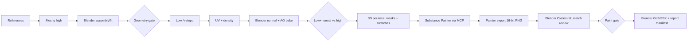

# 01 — Assets3D pipeline overview (as of 2026-10-09)

Analysis of the Tales of Shadowland 3D asset pipeline at `E:\UzmiGames\Assets3D`, written as input for UzPainter (a 100% AI-operated replacement for Adobe Substance 3D Painter). This file describes the end-to-end flow; later files zoom in on Painter usage (02), bake (03), painting (04), export (05), review rendering (06), lessons (07) and derived requirements (08).

## Conventions

- Paths are relative to `E:\UzmiGames\Assets3D\` unless they start with a drive letter. `SM/` abbreviates `Creatures/Undead/Skeletal Mage/Models3D/`. `report.json → key` means a key inside that JSON file.
- Labels: **F** = Fact (stated in, or computed this session from, the cited source), **H** = Hypothesis (inferred, not confirmed by a source), **R** = Recommendation (ours, for UzPainter). "Not confirmed" marks gaps.
- `UzPainter/…` and `UzEngine/…` are paths in `E:\UzmiGames\UzPainter\` and `E:\UzmiGames\UzEngine\`. **Owner** marks a product-owner requirement for UzPainter (stated 2026-10-09 and 2026-10-10; recorded in `UzPainter/README.md` and `UzPainter/.rulebook/decisions/001-acceptance-criterion-output-parity-with-substance-painter.md`).
- Snapshot written 2026-10-09 and corrected 2026-10-10 after the technical review `../reviews/assets3d-pipeline-astra-review.md` (response in [09](09-review-response.md)); the corrections include the hat v8 record dated 2026-10-10 (`SM/10-Chapeu/report.json → v8.date`).
- Only one character has gone through the pipeline so far: the Skeletal Mage (body + 17 equipment pieces) — **F**, `Docs/Pipeline-Guide.md` (first paragraph). All evidence below comes from that character.

## 1. Summary

**F** — The agreed order is: low faithful to the high's construction → shape checked against the original → professional UV validated → bake → low + normal vs high comparison approved → masks → painting → maps checked → render and feedback → lesson recorded (`Docs/Pipeline-Guide.md`, section "Fluxo reutilizável: da low à pintura validada"). Since 2026-10-08 every stage ends with a written gate check and only a pass advances (`AGENTS.override.md` → "Stage quality gates").

**F** — Painting is done exclusively in Substance 3D Painter 12.1, driven through MCP/Python, never by mouse or keyboard (`AGENTS.override.md` → "Working agreements"; `.claude/skills/pbr-painting/SKILL.md`, "A pintura é SEMPRE no Substance Painter"; `Docs/Pipeline-Guide.md`, "Operação por MCP e ferramentas locais"). Everything else — generation, assembly, low/retopo, UV, the geometry normal bake of the checked recipes, mask computation, review rendering, GLB/FBX export — happens in Meshy, Blender 5.2.2 (background workers or MCP) and plain Python/NumPy. This is the observed route, not a product boundary: the owner requires UzPainter to bake mesh maps from the high-poly itself (see 08, BAK-03).

## 2. Actors and responsibilities

| Actor | Role in the pipeline | Type | Source |
|---|---|---|---|
| User (art director) | Gives requests, judges against the reference, gives the only artistic approval; watches a visible Painter/Blender window; forbids mouse/keyboard/focus control of their windows. | F | `AGENTS.override.md` → "Working agreements", "Stage quality gates"; `Docs/Pipeline-Guide.md` ("O usuário proibiu controle de mouse, teclado e foco") |
| Claude (Claude Code) | Construction, fit, authored painting, coordination of every character; opens scoped Astra sessions. | F | `AGENTS.override.md` → "Coordination" |
| Astra (OpenAI Codex CLI/app) | UV, bake, technical QA, infrastructure, image generation (`image_gen` swatches and clean reference edits). | F | `AGENTS.override.md` → "Coordination"; `Docs/Colaboracao/Capacidades.md` |
| Producer vs confirmer | The producer self-inspects; another session confirms the gate; the manifest records both separately. | F | `AGENTS.override.md` → "Coordination"; `Pipeline/manifest/README.md` |
| Collaboration channel | `Docs/Colaboracao/scripts/collab.py` (publish, inbox, exclusive `lock` for Blender and Painter). | F | `Docs/Colaboracao/Colaboracao.md` → "Substance Painter" |

## 3. Tools and versions

| Tool | Version / location | Used for | Source |
|---|---|---|---|
| Meshy image-to-3D | Meshy 7.1, geometry "Ultra 4K" (single image) or 2K (multi-image, 1–4 views); no remesh, decimation, texture generation, resize or auto-rig | High-poly source generation | F — `Docs/Pipeline-Guide.md` → "Geração", "Operação e retomada" |
| Blender | 5.2.2 LTS, `E:/SteamLibrary/steamapps/common/Blender/blender.exe`; only numpy inside (no scipy) | Assembly, low/retopo, UV, normal/AO/mask bakes, review renders, GLB/FBX export | F — `Pipeline/mcp/Environment.md` |
| Blender MCP | `mcp-for-blender` 2.1.3 (PyPI), port 9876, client `Pipeline/mcp/blender_mcp_client.py`; background workers (`blender -b --factory-startup`) preferred | Scene operations | F — `Docs/Pipeline-Guide.md` → "Blender e trabalho conjunto"; `Pipeline/mcp/Environment.md` |
| Substance 3D Painter | 12.1.0, launched with `--enable-remote-scripting`, endpoint `localhost` (IPv6 `::1:60041`) | Mesh-map bakes (some pieces), layer stack, smart materials/masks, export, Iray preview | F — `Docs/Pipeline-Guide.md` → "Operação por MCP e ferramentas locais" |
| Painter MCP | Community `SubstancePainterMCP` (github.com/elliezu) as submodule `Tools/SubstancePainterMCP`, plus local patch `Pipeline/mcp/substance-painter-mcp-local.patch`; 79 tools in `Tools/SubstancePainterMCP/tool-schema.json` (count computed this session) | Bridge between agents and Painter | F — `Docs/README.md` → "Ferramentas (submodules)" |
| Python 3 | numpy, scipy, Pillow | 3D per-texel mask computation, boards, metrics | F — `Pipeline/mcp/Environment.md` |
| Review panel | `Pipeline/panel/panel.py` (stdlib server) + three.js 0.170 viewer | Browser review of GLBs vs references, pivots, equipped composition | F — `Pipeline/panel/README.md` |
| Catalog | `Pipeline/catalog/catalog.py` / `catalog.json` (225 tools, 68 lessons, 3 recipes, 8 swatches; counted this session) | Find existing tools/recipes/lessons; generates `Gates/` and archetype indexes | F — `Docs/Pipeline-Guide.md`; `Pipeline/catalog/catalog.json` |
| Manifest | `Pipeline/manifest/manifest.py` + `manifest-schema-v1.json` | Per-version manifest and character index | F — `Pipeline/manifest/README.md` |

## 4. Stages end to end

| # | Stage | Main tools | Driven by | Key outputs | Gate to advance | Sources |
|---|---|---|---|---|---|---|
| 0 | Reference preparation | Reference sheets in `Creatures/.../Model/` and `Equipment/`; Astra `image_gen` edits ("clean photo of the piece as worn") | Claude + Astra | Per-piece reference PNGs | — | F — `SM/23-Cinto/manifestos/v5.json` (`referencia` entries); `Docs/Lessons/generation-meshy-clean-worn-photo.md` |
| 1 | Generation | `Pipeline/generation/meshy_session.py`, `report_meshy.py`, `inspect_glb.py` | Agent, with user-authorised credits | GLB + OBJ highs (e.g. hat high 667,248 tris; grimoire v2 606,526 tris) kept read-only in `SM/Meshy-High-v*` | Visual selection | F — `Docs/Pipeline-Guide.md` → "Geração"; `SM/10-Chapeu/report.json → source_data` |
| 2 | Assembly / fit | `Pipeline/assembly/*.py` (`place_by_reference_views.py`, `equip_pivot.py`, coverage cuts) | Claude | Assembly `.blend`, `Assembly/equip-placements.json` | Geometry gate | F — `.claude/skills/character-assembly/SKILL.md`; `AGENTS.override.md` → "Never deform a model to fit another", "Equipment pivot" |
| 3 | Geometry gate | `Pipeline/render/render_ref_view_crops.py`, `board_ref_vs_render.py` under `ref_match` | Producer + confirmer | Clay renders at every reference framing | `gates.visual.geometria-encaixe = pass` in the manifest before the Painter project is created | F — `AGENTS.override.md` → "Stage quality gates" §1; `Docs/Lessons/gate-no-paint-on-failed-geometry.md` |
| 4 | Low / retopo | Voxel remesh + decimate + shrinkwrap (`retopo_voxel_low.py`), decimation, per-piece parametric construction scripts (`Pipeline/retopology/hat-v6/`, `staff-v10/`, `waist-v5/`, `wand11-v1/`) | Claude | Low `.blend` (e.g. hat v6 3,498 tris for a 3,500 budget; tunic 11,000) | Silhouette kept within budget | F — `Docs/Pipeline-Guide.md` → "Como escolher a low"; `SM/10-Chapeu/report.json → v6.low` |
| 5 | UV | `Pipeline/uv/*.py`: unwrap/panels/xatlas → `uv_fold_repair_pack.py` → `normalize_uv_islands.py` (10.24 px/cm) → pack → `validate_uv_mesh.py`; texture-set split/join | Astra / Claude | Validated low, `uv/val-<res>.json`, checker renders | Numerical gate + checker review | F — `.claude/skills/professional-uv/SKILL.md`; `Pipeline/retopology/staff-v10/uvchain.sh` |
| 6 | Bake | Blender: `Pipeline/painting/bake_normal_pair.py` (normal), `garment_blender_io.py extract` (AO + raster inputs); Painter bakers on some pieces | Astra / Claude | 16-bit OpenGL normal + `_raw/_coverage/_stages` evidence; AO | Lit low+bake render with no misses, waviness or seam artifacts | F — `Pipeline/retopology/*/bake.sh`; `AGENTS.override.md` → "Stage quality gates" §3 |
| 7 | Low + normal vs high fidelity | `Pipeline/render/render_fidelity_pairs.py` / `render_fidelity_sets.py` | Producer + confirmer | `Review/*Fidelidade*`, `report.json → low_high_fidelity` | `pass`; `fail`/`pending` blocks painting | F — `Docs/Pipeline-Guide.md` (table "Etapa / Evidência para seguir") |
| 8 | Material masks | `garment_material_masks.py fields/masks` and piece scripts (`hat_masks.py`, `staff_masks.py`, `waist_masks.py`, `iron_material_masks.py`, `leather_distress_masks.py`, `bone_material_masks.py`, `book_material_masks.py`, …) | Claude | `M_*.png` (16-bit, padded) and `T_*.png` (sRGB projected swatches) | Private mask check only | F — `.claude/skills/pbr-painting/SKILL.md` → "Máscaras de material em 3D"; `Pipeline/painting/` docstrings |
| 9 | Colour swatches | Astra/Codex `image_gen`; `Docs/Library/Swatches/<id>/` with `provenance.json` | Astra | Flat seamless BaseColor PNGs | Swatch visual check | F — `Docs/Library/README.md`; `Docs/Library/Swatches/hammered-iron-v2/provenance.json` |
| 10 | Painting | Painter via `painter_create.py`, `Pipeline/painting/painter_layer_stack.py sync/smart`, `painter_export.py` | Claude (authored painting) | `.spp`, exported maps | Paint gate (vs-ref board under `ref_match`, tonal targets, reference details present) | F — `Pipeline/retopology/waist-v5/round.sh`; `AGENTS.override.md` → "Stage quality gates" §4 |
| 11 | Review render | Blender Cycles `paintrender.py` per piece (`ref_match` at reference framing), boards; Painter Iray live capture; review panel | Producer + confirmer + user | `Review/` PNGs, boards, tone stats | Same paint gate | F — `Pipeline/retopology/staff-v10/paintrender.py`; `Pipeline/render/Render-Comparison.md` |
| 12 | Delivery | `deliver.py` per piece (game low + material, GLB with tangents, FBX), `report_v*.py`, `manifest.py build/index` | Producer | `<piece>-vN.blend`, `Export/*.glb/.fbx`, `Textures/`, `report.json`, `manifestos/vN.json`, `pecas-index.json` | Coherent round across `.spp/.blend/maps/GLB/FBX/Review` | F — `Pipeline/retopology/staff-v10/deliver.py`; `Docs/Lessons/export-coherent-round.md` |
| 13 | Character integration | `SM/Assembly/Skeletal-Mage-Assembly-v*.blend`, `equip-placements.json`, review panel | Claude | Assembly scenes, equipped composition | User review | F — `Docs/Pipeline-Guide.md` → "Montagem v7"; `Pipeline/panel/README.md` |

## 5. Where Painter sits, and what it does not do

| Statement | Type | Source |
|---|---|---|
| Painter receives an already-validated low (OBJ), an externally baked tangent normal and (since 2026-10-09) an externally baked AO, then hosts the editable layer stack and exports the maps. | F | `Pipeline/retopology/staff-v10/painter_create.py`; `.claude/skills/pbr-painting/SKILL.md` ("importar a low e o normal assado; importar as máscaras 3D como recursos; montar a pilha com `painter_layer_stack.py sync`") |
| Material masks are computed outside Painter (NumPy, per texel, in 3D) and imported as bitmap resources; Painter layers are mostly uniform-colour fills masked by those bitmaps. | F | `AGENTS.override.md` → "Paint standard" steps 2–4 |
| Blender composites of masks are allowed only as private mask checks, never as a paint round or a delivered map. | F | `AGENTS.override.md` → "Working agreements" ("Painting is always in Substance Painter") |
| Final review renders and gate boards are made in Blender Cycles, not in Painter's viewport; Painter's viewport light hid albedo variation that Cycles showed. | F | `.claude/skills/pbr-painting/SKILL.md` → "Peça orgânica: 00-Corpo" ("julgar só no viewport do Painter engana") |
| GLB/FBX are exported by Blender from copies of the low, with Painter maps wired into a Principled BSDF. | F | `Pipeline/retopology/staff-v10/deliver.py`; `.claude/skills/pbr-painting/SKILL.md` step 9 |

## 6. Handoff formats

| Artifact | Format | Producer → consumer | Notes | Source |
|---|---|---|---|---|
| High source | Meshy GLB/OBJ; working high inside `.blend`; per-part highs in bake scenes | Meshy → Blender | Originals never overwritten; working highs are copies | F — `Docs/Pipeline-Guide.md` → "Conferência e próximos estágios" |
| Low for Painter | OBJ (triangulated low exported from Blender; `usemtl <name>` sets the texture-set name) | Blender → Painter | e.g. `_tmp/claude/cajado-v10/paint/09-Cajado-v10_low.obj` | F — `Pipeline/retopology/staff-v10/painter_create_args.json`; `SM/22-Bracal-Direito/report.json → painting.mesh` |
| High for Painter bakers | OBJ exported triangulated with normals | Blender → Painter | Painter writes an `.assbin` cache next to it | F — `SM/00-Corpo/report.json → painting_v6.rebake_mesh_maps.high`; `SM/22-Bracal-Direito/report.json → painting.mesh_maps.note` |
| Geometry normal | 16-bit RGB PNG, OpenGL tangent space | Blender → Painter (mesh-map resource) | `<piece>_Normal_OpenGL_v<N>.png` | F — `Pipeline/painting/bake_normal_pair.py` docstring; `painter_create.py` |
| AO | 16-bit PNG written from `ao.npy` | Blender/Python → Painter (mesh-map resource) and delivery | Delivery wired as glTF occlusion only in `Pipeline/retopology/hat-v6/deliver_v8.py`; the other checked deliver scripts (staff v9/v10, hat v6, belt/sash v5, wand v1) load no AO map (search this session) | F — `Pipeline/retopology/waist-v5/sashchain.sh`; `Docs/Lessons/painting-ao-ray-misses-and-definition.md`; `Pipeline/retopology/*/deliver*.py` |
| Masks / colour textures | `M_*.png` 16-bit grayscale padded; `T_*.png` sRGB 8-bit already in final UV | Python → Painter (project resources) | | F — `Pipeline/painting/garment_material_masks.py`, `iron_material_masks.py` docstrings |
| Layer stack recipe | Stack JSON (`title`, `groups`, `layers`) + session state JSON | Agent → `painter_layer_stack.py` → Painter | | F — `Pipeline/painting/painter_layer_stack.py` docstring |
| Exported maps | PNG 16-bit (BaseColor sRGB; others Raw), normal OpenGL combined | Painter → Blender | Hat v8 adds `SpecularWeight` (delivered as an 8-bit RGBA PNG; header read this session) and delivers the Blender AO bake: seven maps | F — `Pipeline/retopology/staff-v10/painter_export.py`; `SM/10-Chapeu/report.json → painter_recipe.export`, `v8.files_sha256`; `Pipeline/retopology/hat-v6/painter_export_v8.py` |
| Game asset | `.blend` (game low + hidden high), GLB (tangents), FBX | Blender → review panel / assembly / future engine | | F — `Pipeline/retopology/staff-v10/deliver.py` |
| State and evidence | `report.json` per piece, `manifestos/vN.json`, `pecas-index.json`, `Review/*.png` | All → all | Manifests are generated, never hand-written | F — `Pipeline/manifest/README.md` |

## 7. State stores and folder rules

| Store | Rule | Type | Source |
|---|---|---|---|
| `SM/<NN-Piece>/` | Holds `vN.blend`, `vN.spp`, `Textures/`, `Export/`, `Review/`, `Source/`, `report.json`, `manifestos/` | F | Directory listing this session; `Docs/README.md` ("Saber o estado de uma peça") |
| `_tmp/<agent>/<job>/` | Work in progress; scripts promoted to `Pipeline/<stage>/` on delivery | F | `Pipeline/mcp/Environment.md` → "Trabalho em andamento" |
| Git | Text only; `.blend`, `.spp`, `.glb`, `.fbx`, `.obj`, textures and Review images are git-ignored; `Creatures/` ≈ 37 GB and `_tmp/` ≈ 42 GB on 2026-10-09 | F | `Pipeline/mcp/Environment.md` |
| Versions | Keep the current version plus the previous checkpoint; approved assets are never deformed or repainted in place | F | `README.md` (root); `AGENTS.override.md` → "Protect approved work" |

## 8. Timeline of the Painter-related process

| Date | Event | Type | Source |
|---|---|---|---|
| 2026-10-04/05 | Hat v4/v5 pilot: Painter bakes all mesh maps, manual + MCP stack, "Blender (Principled BSDF)" 4K/16-bit export; local MCP patch (bake without UDIM, mask resource assignment, OCIO colours) | F | `SM/10-Chapeu/report.json → painter_recipe`; `git log` commit `92e3cc3` (2026-10-05) |
| 2026-10-05 | Tunic v9/v10 approved: 3D per-texel masks + uniform fills (`painter_layer_stack.py sync`); declared the paint standard for every piece on 2026-10-08 | F | `SM/18-Tunica/report.json → artistic_approval`; `AGENTS.override.md` → "Paint standard" |
| 2026-10-07 | "Painting is ALWAYS in Substance" directive; body split into three texture sets; layer-isolation tool; bake tool keeps RAW and repairs padding only | F | `.claude/skills/pbr-painting/SKILL.md`; `git log` `37efb2b`, `994c238` |
| 2026-10-08 | Stage gates binding; per-part bake, cage fill, hidden mask; bracer leather family; `ref_match` preset v3 | F | `AGENTS.override.md`; `git log` `2b729eb`, `192bea6`; `Pipeline/render/Render-Comparison-Standard.json → presets.ref_match.calibration.date` |
| 2026-10-09 | Construction-driven pieces (hat v6, staff v9/v10, wand v1, belt/sash v5) with Blender normal + AO as Painter mesh maps and a custom inline export preset; lighting-independent definition directive; equipment pivot convention | F | `Pipeline/retopology/*/README.md`; `AGENTS.override.md` → "Definition independent of the lighting", "Equipment pivot" |
| 2026-10-09/10 | Hat v8: Painter project copied from v6; stack of 43 layers in 5 groups; OpenPBR `SpecularWeight` channel added (felt 0.5, leather/iron 1.0); corrected Blender AO as the Painter AO mesh map and as a delivered map wired to glTF occlusion; seven delivered maps; artistic approval pending | F | `SM/10-Chapeu/report.json → v8`; `Pipeline/retopology/hat-v6/README.md` → "v8" |

## 9. Open points

- **Not confirmed:** whether any engine (UzEngine, Unreal) currently consumes the deliverables. Assets3D states that "conversion to Unreal and compression/packing are a later stage" (`.claude/skills/pbr-painting/SKILL.md` step 8); the hat v8 report states an Unreal mapping for its specular map (pin Specular = 0.5 × SpecularWeight, `SM/10-Chapeu/report.json → v8.export_notes`), but no executed Unreal import is recorded. See 05.
- **Not confirmed:** how binaries (`.spp`, textures) move between machines; Git LFS vs a shared folder is undecided (`Pipeline/mcp/Environment.md`).
- **F** — `AGENTS.override.md` → "Working agreements" still reads "Painting is always in Substance Painter". **R** — The owner already requires UzPainter to fully replace Painter in this pipeline, so no new permission is needed; the Assets3D governance text should be aligned before the first UzPainter production round (see 08, G-01).
