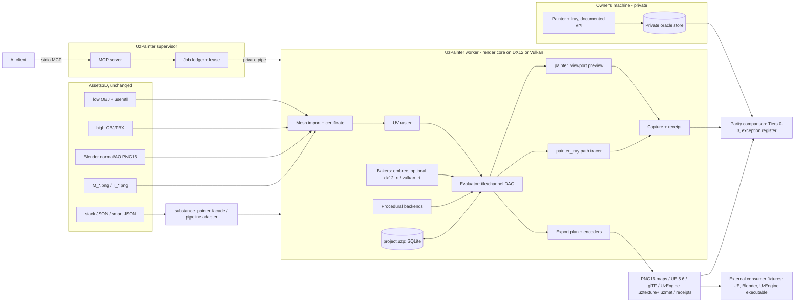

# 01 — System overview

Decision context: `docs/analysis/architecture-discussion/05-resolution.md` (D1–D14) as updated by the owner's answers of 2026-10-10 (`docs/open-questions.md`; decisions 016–027). Requirements: `docs/prd.md`. This document fixes the system context, the vocabulary and the component boundaries every other architecture document uses.

## 1. System context

- **Standalone, with zero dependency on UzEngine** (Q8, decision 021). UzPainter copies (vendors) the rendering code it needs — RHI, shader pipeline, DXR primitives, readback, platform helpers, format definitions — from a clean UzEngine commit into `thirdparty/uzengine-render-core/`, keeps the Apache-2.0 headers and records the attribution in `NOTICE`. There is no link against `runtime.lib`, no DLL, no submodule, no pin, no patch queue and no upstream obligation; UzPainter has its own build (`13-engine-integration.md`). UzEngine may consume UzPainter as a submodule in the future, not now.
- **Platform** (Q9, decision 022): Windows 10/11 x64 only; DX12 primary and Vulkan as the second backend on Windows, selected per worker; no Linux/macOS now; one-folder distribution. CPU baking needs no GPU and runs on the configurations qualified for the pinned Embree build; compositing, preview and path tracing require a GPU.
- **Reference oracle:** Adobe Substance 3D Painter, installed on the owner's machine and driven only through its documented Python API plus a qualified capture procedure for pixels. Texture outputs are compared exactly (Q1, decision 017); **Painter's Iray is the render-parity target** (Q2, decision 018), matched by UzPainter's clean-room path tracer on DXR and Vulkan ray tracing. Every recorded Painter output stays in the private oracle store on the owner's machine, where every GPU and oracle check runs locally (decision 028; `14-parity-testing.md` §6–§7). Nothing from Adobe is copied or shipped (decision 002).
- **Clients:** AI clients over MCP; the Assets3D pipeline through `UzPainter.exe run` and the UzmiGames pipeline adapter; a human through the read-only preview window.
- **Consumers of exports, outside UzPainter:** Unreal Engine 5.6, glTF tools, Blender scripts and UzEngine's own executable, each exercised by an external consumer fixture; UzPainter writes `.uztexture`/`.uzmat` with its own code (Q10).

## 2. Vocabulary

| Term | Meaning |
|---|---|
| **Document** | The in-memory project: texture sets, stacks, channels, layer trees, sources, resources, mesh maps, bake settings, display state. Serialised as the JSON **manifest**. |
| **Revision** | Monotonic integer incremented by every committed mutation of the document. Jobs evaluate an immutable snapshot of one revision. Results, exports and captures name the revision they came from. |
| **Operation record** | `{project_uuid, idempotency_key, request_hash, outcome, committed_revision}`, persisted atomically with the revision it produced; the supervisor reconciles its job ledger from these records before admitting a retry (`02-runtime-topology.md`, `09-project-file-format.md`). |
| **Resource** | Immutable bytes identified by SHA-256 (images, meshes, HDRIs, presets). Nodes bind resources by hash plus an optional alias name. |
| **Mesh map** | A per-texture-set raster in a `MeshMapUsage` slot (Normal, WorldSpaceNormal, ID, AO, Curvature, Position, Thickness, Height, BentNormals, Opacity), baked natively or imported, with provenance. |
| **Evaluator** | The GPU compute pipeline that turns the document into channel rasters, tile by tile. Its semantic version (`evaluator_profile`) is stored in the project. |
| **Plane** | An authoritative raster that cannot be re-evaluated from a recipe (a bitmap received by a paint layer, a frozen procedural snapshot); identified by a persistent `plane_id` referenced by its owning node and stored in the project at native precision. Brush strokes are out of scope (Q5, decision 019). |
| **Render core** | The rendering code vendored from UzEngine plus UzPainter's own GPU layer on top of it (`TextureReadback`, UV raster, kernels, path tracer) on DX12 or Vulkan (`13-engine-integration.md`). |
| **Job** | A long operation (bake, export, capture, import, reload) with a `job_id`, progress, cancellation and a terminal status bound to that id. |
| **Capability manifest** | The generated list of every Painter Python symbol and every UzPainter operation with its status: `supported`, `desktop-only-omitted`, `release-gap`. |
| **Golden** | A recorded Painter output (map, intermediate plane, Iray render or API readback) with its full input manifest, used as the private oracle for parity tests; only its hash is public. |
| **Exception register** | The owner-approved, versioned exceptions (`parity/exceptions.json` plus a decision each); the only way a non-zero difference passes (`14-parity-testing.md` §5). |
| **Tier 0–3** | Parity test tiers: semantics micro-tests, recipes, procedurals and bakes, renders (path tracer vs converged Iray references) (`14-parity-testing.md`). |

## 3. Components

| Component | Language / host | Responsibility | Doc |
|---|---|---|---|
| Supervisor | C++ host + embedded CPython running the official MCP SDK | Launched by the AI client (`UzPainter.exe --mcp`); owns MCP connectivity, admission, the job ledger, the mutation lease and worker lifecycle; never initialises a GPU | 02, 11 |
| Worker | C++ (`UzPainter.exe --worker`) + embedded CPython | Owns one document, the render core on the selected backend, the evaluator, bakers, exporter, renderers and the compatibility interpreter | 02 |
| Document model | C++ (`uzp_core`) | Typed project model, JSON manifest, revisions, operation records, capability manifest generator | 03, 04 |
| Resource store | C++ | Content-addressed blobs, decoded raster cache in RAM/VRAM, provenance | 03, 09 |
| Mesh module | C++ | OBJ/FBX/glTF raw import, texturing mesh, MikkTSpace tangents, UV/TBN certificate, UV-space rasterisation, high-poly streaming | 12 |
| Render core | C++ (vendored from a clean UzEngine commit) + UzPainter-owned layer | RHI with DX12 and Vulkan backends, shader pipeline (DXC to DXIL and SPIR-V), DXR and Vulkan ray-query acceleration structures, `TextureReadback`, capability queries, VRAM admission | 13 |
| Evaluator | C++ + generated HLSL compute on the render core | Tile/channel DAG, per-node kernels, blend modes, masks, projections, height→normal, dilation, quantisation profile | 04 |
| Procedural backends | C++/HLSL | Independently implemented certified resource families and project-private frozen snapshots behind `IProceduralBackend`; no Adobe runtime adapter or redistributed Adobe content | 05 |
| Baker | C++ behind `IBaker` | Ten mesh-map bakers with Painter parameter names and evidence maps; `embree` (CPU, Embree 4.x) first; optional `GpuBaker` with `dx12_rt` and `vulkan_rt` backends later | 06 |
| Renderers | C++/HLSL | `painter_iray`: clean-room path tracer on DXR and Vulkan ray query — the render-parity target; `painter_viewport`: realtime forward pass — human preview and fast check only; diagnostic channel captures | 07 |
| Exporter | C++ | Painter JSON export plan compiler, encoders, presets, `.uztexture`/`.uzmat` writers (UzPainter's own code), receipts | 08 |
| Project store | C++ (SQLite + zstd) | Self-contained `.uzp` file, revisions, operation records, autosave, checkpoints, `inspect`, `export-bundle` | 09 |
| `uzpainter` module | C++ (pybind11, linked into the exe) + Python | Native API; `substance_painter` facade (documented symbols only); `uzpainter.cli`; `uzpainter.mcp`; the UzmiGames pipeline adapter is separate UzmiGames code | 10, 11 |
| Preview window | C++ | Optional read-only window on its own thread; shows `painter_viewport` frames and the latest `painter_iray` capture; never pauses work | 07 |

## 4. Process roles and entry points

```
UzPainter.exe --mcp [--mcp-http 127.0.0.1:<port>] [--roots ...] [--allow-python] [--gpu-backend dx12|vulkan]
    supervisor: MCP server (stdio by default) → spawns and supervises one worker
UzPainter.exe --worker --pipe <name> --gpu-backend dx12|vulkan [--allow-python]
    worker: document + render core; talks only to its supervisor
UzPainter.exe run <script.py> [args]
    single process: worker role hosting a Python script (substance_painter facade available)
UzPainter.exe inspect <file.uzp> | export ... | bake ... | capture ... | selftest | export-bundle ... | assets list [--parity] | capabilities
    CLI verbs, single process; prefixed JSON lines on stdout (`UZP_JSON:{...}`), exit codes 0/1/2/3
UzPainter.exe --preview <file.uzp>
    read-only window following a project (optional; also attachable to a running worker)
```

## 5. Threads inside the worker

| Thread | Owns | Rules |
|---|---|---|
| Python command thread (interpreter main thread) | Scripts, typed command handlers | Acquires the document lock for mutations; releases the GIL around render-core calls |
| Python dispatcher thread | `substance_painter.event` dispatch and facade callbacks | Delivers events in Painter's documented order after committed transitions, even if the script that started the operation already returned; never holds the document lock while running Python callbacks |
| Engine thread (UzPainter's GPU thread) | The RHI device of the selected backend, command lists, evaluator caches, GPU jobs | Only thread that touches the device; processes a queue of evaluation/capture requests against revision snapshots |
| Job pool (UzPainter's job system) | Embree baking, encoders, mesh parsing, zstd | CPU work; cancellation checked at tile boundaries |
| Preview thread (optional) | Window message loop, low-rate present | Reads the last completed evaluation through a double buffer |

## 6. Data flow



## 7. Cross-cutting rules

1. **Every mutation is a transaction** under the document lock and produces a new revision with its operation record; composite operations attach a detached subtree only on success (`03-project-model.md` §6).
2. **Jobs evaluate immutable revisions**; every result, export and capture names `revision`, `evaluator_profile`, resource hashes, backend and job id in its receipt.
3. **Nothing is silently a no-op.** Unsupported symbols raise `UnsupportedInUzPainter`; unimplemented but output-affecting features are listed as release gaps in the capability manifest (`10-python-api.md` §3).
4. **Painter's observable behaviour wins in the facade**, including quirks that change output (`10-python-api.md` §4); the native `uzpainter` API may be safer.
5. **Parity before convenience.** A kernel, baker or preset is not accepted until its tier passes against Painter goldens recorded through Painter's documented API and qualified capture procedure; exact equality is the rule, and a difference passes only through the exception register (`14-parity-testing.md`).
6. **Paths are canonical absolute Windows paths** checked against allowlisted roots; project-internal references are hashes, never paths.
7. **Owner decisions.** Every owner answer is a recorded decision (`docs/open-questions.md`); code that would change one waits until the owner decides (`rulebook_task ask`).
8. **No engine link.** No UzPainter code links, loads or calls UzEngine; the vendored render core is UzPainter source, and UzEngine appears only as an external export consumer.
9. **Private oracle.** Painter outputs never enter the repository or a release; the repository holds their hashes and independently authored inputs only (`14-parity-testing.md` §6).
