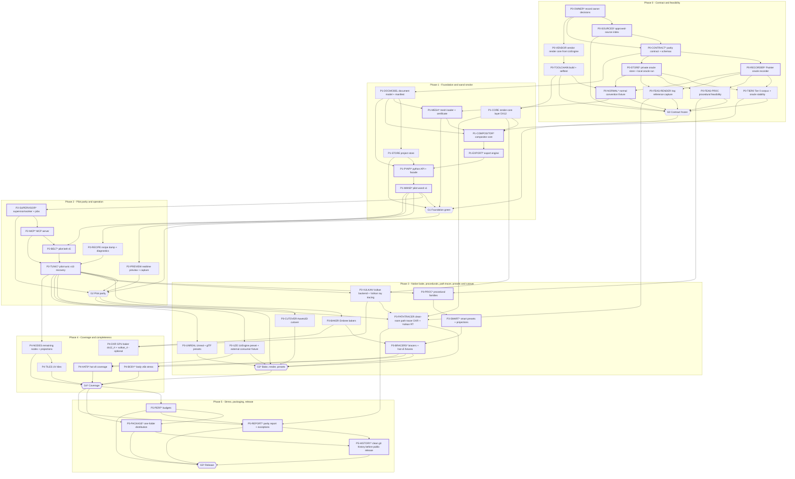

# Work-package dependency graph

Nodes are the work packages of `roadmap.md`; the `Rulebook task id` column is canonical (`phase<N>.<M>_<kebab-name>`, see Task decomposition rule); the short `P…`/`G…` labels are diagram aliases. The graph is acyclic. Gate nodes `G0`–`G5` join every mandatory acceptance item of their phase, and each gate requires the previous gate, so `G5` (release) cannot be reached without every mandatory node; a work package carrying a gate's evidence cannot close the gate by itself. Critical-path nodes are marked `*`.

Round-4 changes (owner answers of 2026-10-10 recorded in `docs/open-questions.md`; Astra findings F03, F06, F07, F08, F14, F17, F18, F19 in `docs/analysis/reviews/docs-set-astra-review.md`):

| Change | Ids |
|---|---|
| Removed | `phase0_engine-pin` (P0-PIN: pin, patch queue, upstream obligation — owner Q8, decision 021); `phase4_paint-strokes` (P4-STROKES — brush strokes out of scope, owner Q5, decision 019) |
| Added | `phase0.1_approved-source-index` (P0-SOURCES), `phase0.5_vendor-render-core` (P0-VENDOR), `phase3.3_vulkan-backend-ray-tracing` (P3-VULKAN), `phase3.7_path-tracer` (P3-PATHTRACER), `phase5.5_clean-history` (P5-HISTORY, decision 027), gate nodes `phase0.10_gate-g0` … `phase5.6_gate-g5` (G0–G5) |
| Renamed | `phase1_engine-integration-layer` → `phase1.4_render-core-layer` (P1-ENGINE → P1-CORE; no UzEngine integration exists any more); `phase2_parity-viewport` → `phase2.3_realtime-preview` (P2-VIEWPORT → P2-PREVIEW; the viewport is preview only, owner Q2, decision 018); `phase5_assets3d-cutover` → `phase3.1_assets3d-cutover` (P5-CUTOVER → P3-CUTOVER; the cutover follows Tunic v10's parity gate, owner Q13, decision 026) |
| Kept, retargeted | `phase0.9_render-reference-capture` (P0-FEAS-RENDER) now captures converged **Iray** references (owner Q2, decision 018); `phase4.3_dxr-baker` (P4-DXR) is now the optional `GpuBaker` with `dx12_rt` and `vulkan_rt` backends (`architecture/06-baking.md`) |

## Graph

## Critical path (provisional)

Longest *dependency* chain, pending task decomposition and per-node duration estimates (phase durations are Hypotheses in `roadmap.md`); it is not a measured longest-duration path. Every node on a chain of maximal length is marked `*`:

`P0-OWNER → P0-SOURCES → P0-CONTRACT → {P0-RECORDER | P0-STORE} → P0-NORMAL → P1-MESH → P1-COMPOSITOR → P1-EXPORT → P1-PYAPI → P1-WAND → P2-SUPERVISOR → P2-MCP → P2-BELT → P2-TUNIC → P3-PROC → P3-SMART → P3-BRACERS → {P4-HAT8 | P4-BODY | G3} → G4 → P5-PERF → {P5-PACKAGE | P5-REPORT} → P5-HISTORY → G5` (23 nodes; braces are equal-length alternatives).

Near-critical legs that are mandatory prerequisites, not side projects: the render-core leg `P0-VENDOR → P0-TOOLCHAIN → P1-CORE → P1-COMPOSITOR`; the Tier 0 leg `P0-RECORDER → P0-TIER0 → P1-COMPOSITOR`; the render leg `P0-FEAS-RENDER`, then `P2-TUNIC → P3-VULKAN → P3-PATHTRACER → G3 → G4` (one node shorter than the procedural leg); and the cutover leg `G2 → P3-CUTOVER → G3`.

## Parallel groups

- **Phase 0** after `P0-OWNER`: {`P0-SOURCES`, `P0-VENDOR`}, then {`P0-CONTRACT`, `P0-TOOLCHAIN`}, then {`P0-RECORDER`, `P0-STORE`}, then {`P0-TIER0`, `P0-FEAS-PROC`, `P0-FEAS-RENDER`, `P0-NORMAL`}.
- **Phase 1:** {`P1-CORE`, `P1-DOCMODEL`}, then {`P1-STORE`, `P1-MESH`}, then `P1-COMPOSITOR → P1-EXPORT → P1-PYAPI → P1-WAND`.
- **Phase 2:** {`P2-SUPERVISOR`, `P2-PREVIEW`, `P2-RECIPE`}, then `P2-MCP`, then `P2-BELT → P2-TUNIC`.
- **Phase 3:** {`P3-BAKER`, `P3-PROC`, `P3-VULKAN`, `P3-UZE`, `P3-UNREAL`} after `P2-TUNIC`, and `P3-CUTOVER` after `G2`; then {`P3-SMART`, `P3-PATHTRACER`}; then `P3-BRACERS`.
- **Phase 4:** {`P4-HAT8`, `P4-BODY`, `P4-NODES`, `P4-DXR`} (`P4-NODES` may start right after `P2-TUNIC`), then `P4-TILES`.
- **Phase 5:** `P5-PERF`, then {`P5-PACKAGE`, `P5-REPORT`} on the same frozen build, then `P5-HISTORY`.

## Gate rule

Each phase gate joins every mandatory acceptance item named in `roadmap.md`: its direct inputs are the phase's terminal items, every other mandatory item of the phase reaches the gate through them, and each gate also requires the previous gate. A work package carrying a gate's evidence cannot close that gate by itself. G5 additionally requires every in-scope capability to be supported or covered by an explicit owner scope decision; reporting a gap is not equivalent to accepting it. Performance tuning (`P5-PERF`) finishes before the release build is frozen; packaging verification (`P5-PACKAGE`) and the final parity report (`P5-REPORT`) refer to the same immutable build hash and dependency lock, and any later change reopens both. The clean-history item (`P5-HISTORY`) is verified against that same released tree. Optional `P4-DXR` is not a predecessor of any gate.

Static validation of this file (round 4): 49 nodes, 98 edges; Mermaid edges equal the `Inputs` column; no cycle; no duplicate task id; every task id matches its phase; every node except optional `P4-DXR` reaches `G5`; the `*` marks equal the set of nodes on a longest chain.

## Corpus migration assumption (brush strokes)

Brush strokes are out of scope (owner Q5) and migration goes only through Painter's documented API (owner Q6). If a required fixture cannot be migrated through documented APIs, record `not_migratable` with the reason and keep its affected gate blocked. Excluding or replacing that fixture requires an explicit owner scope decision recorded in the capability manifest and gate report; reporting the limitation alone never closes the gate. Existing paint content may be imported as bitmaps when the documented export route preserves the required output. This applies to the fixtures of `P3-BRACERS`, `P4-HAT8` and `P4-BODY` (for example a paint layer or Paint effect in hat v5). Settling check: a gate fixture marked `not_migratable` with no owner scope decision fails the gate, even if every remaining fixture passes.

## Task decomposition rule

The node ids are stable **parent work packages**. Before implementation tasks are created, large parents are split into independently reviewable child tasks with their own artifact, acceptance fixture and prerequisite edges; task ids are `phase<N>.<M>_<kebab-name>`, where `<M>` is the dependency level inside phase `<N>` (1 + the highest level of its same-phase prerequisites); tasks with the same `<N>.<M>` can run in parallel; children come before their parent; the phase gate is the last level; child ids name the parent (e.g. `phase1.10_compositor-blend-kernels`, `phase1.11_compositor-mask-effects`, `phase1.12_compositor-height-normal`; `phase3.1_baker-request-model`, `phase3.2_baker-normal`, `phase3.4_baker-ao`, `phase3.3_baker-evidence-publication`; `phase3.2_proc-snapshot-backend`, `phase3.2_proc-generator-families`, `phase3.2_proc-grunge-families`; `phase3.1_vulkan-compute-parity`, `phase3.2_vulkan-ray-tracing`; `phase3.4_path-tracer-transport`, `phase3.5_path-tracer-materials`, `phase3.6_path-tracer-tier3-report`; `phase4.1_nodes-instances-anchors`, `phase4.1_nodes-mask-effects`, `phase4.1_nodes-projections`, `phase4.1_nodes-vector-font-sources`). A parent closes only when all mandatory children pass. The full list of task ids by phase and level is `task-index.md`. Tier 0 **reference capture** (`P0-TIER0`) is separate from the acceptance of the smaller Phase 1 compositor subset: each package names the tests it owns, so a partial compositor is not required to pass later-feature tests prematurely.

## Nodes

| Id | Name | Phase | Inputs | Outputs / artifacts | Acceptance gate | Rulebook task id | Implements |
|---|---|---|---|---|---|---|---|
| P0-OWNER | Record owner decisions | 0 | — | Rulebook decisions for the owner's 2026-10-10 answers (Q1, Q2, Q5–Q14, repository history) as listed in `open-questions.md` | Decisions recorded without re-asking decided points; work consistent with a recorded decision proceeds; only an operation that would change a decision waits for the owner | `phase0_owner-decisions` | all |
| P0-SOURCES | Approved-source index | 0 | P0-OWNER | `docs/approved-sources.md`: public specifications/papers (incl. the NVIDIA MDL specification and the BSD-3 MDL SDK), public Adobe documentation pages, UzmiGames files, and the exact revisions/hashes of historical analyses cleared by an itemised provenance audit; quarantine list | Index published; every architecture doc cites only approved sources | `phase0.1_approved-source-index` | CLR, F04 |
| P0-CONTRACT | Parity contract and schemas | 0 | P0-OWNER, P0-SOURCES | `parity/CONTRACT.md` (exact equality, tiers, exception register — Q1), `parity/schema/golden-public.json` (authored inputs, public-documentation-derived expectations, software identities, hashes), `parity/schema/golden-private.json` (every recorded Painter output incl. readbacks, default/template captures and Iray references), `parity/exceptions.json` schema, comparison tool spec | Reviewed; schemas validate samples; no recorded output fits the public schema | `phase0.2_parity-contract` | D13 |
| P0-RECORDER | Painter oracle recorder | 0 | P0-CONTRACT | `tools/parity/recorder/*.py`: documented Python API for state; a qualified, permitted capture procedure for pixels (texture export, Iray render export) with readiness and current-frame verification; operator-recorded form for render settings the API does not expose; every golden recorded twice | A Tier 0 sample recorded end to end; no bridge code path; no private interface | `phase0.3_painter-oracle-recorder` | D13, CLR |
| P0-STORE | Private oracle store and local oracle run | 0 | P0-CONTRACT | `UZP_PARITY_STORE` content-addressed store on the owner's machine; the local oracle run procedure documented and executed once on the owner's machine (GPU, licensed Painter 12.1.0, store; decision 028 — no GPU CI, hosted CI skips oracle tests with an explicit reason); `uzpainter parity fetch/verify/record` prototypes; repository guard for private records (hash match against the store index and public-schema validation, not only file signatures) | Fetch/verify round trip on the owner's machine; guard blocks a recorded PNG and a recorded JSON readback and passes an authored fixture image and an authored expectation JSON | `phase0.5_private-oracle-store` | D13, CLR-05 |
| P0-TIER0 | Tier 0 corpus and oracle stability | 0 | P0-RECORDER, P0-STORE | Private goldens for `04-…` §9, baking defaults, template channel formats, API probes (blobs in the store, hashes in public manifests); stability report; first `parity/semantics/*.json` fits with residuals (public numbers) | Each golden recorded ≥ 2×; stability classified; fits published | `phase0.8_tier0-goldens` | D3, D5, D9, D13 |
| P0-VENDOR | Vendor render core from UzEngine | 0 | P0-OWNER | `thirdparty/uzengine-render-core/` **copied, not linked**, from a clean UzEngine commit (RHI with DX12 and Vulkan backends, shader pipeline, DXR primitives, readback primitives, platform, crash handler, format definitions); `ORIGIN.md` (commit hash for attribution only), `NOTICE` entries, Apache-2.0 headers kept, modification markers; known defects fixed in the copy or the path avoided (glTF cook stride avoided) | Builds standalone in UzPainter's own build; no `runtime.lib`, no submodule, no engine path, no pin or patch queue | `phase0.5_vendor-render-core` | D12 |
| P0-TOOLCHAIN | Build and selftest | 0 | P0-VENDOR | `build.zig` (Zig-first unless the vendored subset dictates otherwise), `UzPainter.exe selftest` (DX12 hardware adapter, compute, readback, PNG16, CPython import and exception round trip, MCP SDK import, Embree, DXR and Vulkan/Vulkan ray-tracing availability probes, WARP probe), link map, DLL closure | Hardware slice green on the owner's machine; WARP probe completed and reported (supported capabilities, executed checks, unsupported reasons) — WARP failure leaves that path unsupported and does not fail G0; CPython boundary qualified or fallback chosen | `phase0.8_toolchain-slice` | D12, D1 |
| P0-FEAS-PROC | Procedural feasibility | 0 | P0-RECORDER, P0-STORE | Black-box calibration of two mesh-map generators and Leather Damaged on the sphere/cube fixtures; residual report | Residuals published; go/no-go for Phase 3 scope | `phase0.6_procedural-feasibility` | D4 |
| P0-FEAS-RENDER | Iray reference capture | 0 | P0-RECORDER, P0-STORE | Evidence-backed answer for every "not confirmed" row of `07-…` §2.1; qualified Iray capture procedure (`07-…` §2.2: Save Render after convergence, readiness and current-frame verification); per analytic fixture, converged references recorded twice in separate sessions plus once at k·S samples (blobs private, hashes public); operator-recorded render settings (private); noise-floor report; first clean-room lobe fits with residuals; DXR Tier 1.1 and Vulkan ray-query probes on the owner's GPU | Procedure qualified; references admitted; noise floor measured; fixture values proposed to the owner for ratification | `phase0.9_render-reference-capture` | D6 |
| P0-NORMAL | Normal convention fixture | 0 | P0-RECORDER, P0-STORE, P0-TOOLCHAIN | Hemisphere normal baked in Painter vs computed by the UzPainter prototype; tangent-frame verdicts | Convention and per-fragment frame settled with evidence | `phase0.9_normal-convention-fixture` | D11, D6 |
| G0 | Gate: Contract frozen | 0 | P0-SOURCES, P0-TIER0, P0-TOOLCHAIN, P0-FEAS-PROC, P0-FEAS-RENDER, P0-NORMAL | Gate record in `parity/reports/` | All joined items accepted | `phase0.10_gate-g0` | D14 |
| P1-CORE | Render-core layer (DX12) | 1 | P0-TOOLCHAIN | UzPainter-owned layer on the vendored RHI: device/queue wrapper, kernel compile + cache (DXIL and SPIR-V), `TextureReadback`, UV raster pass, dilation, resampling, mip generation, capability query; qualified on DX12 behind backend-neutral interfaces | Unit tests on synthetic meshes; readback drain tests on DX12 | `phase1.4_render-core-layer` | D12, D3 |
| P1-DOCMODEL | Document model and manifest | 1 | P0-CONTRACT | `uzp_core` types, canonical JSON manifest + schema, revisions, transactions, operation records `{project_uuid, idempotency_key, request_hash, outcome, committed_revision}`, capability manifest generator | Round-trip tests; digest stable | `phase1.3_document-model` | D3, D2 |
| P1-STORE | Project store | 1 | P1-DOCMODEL | Self-contained portable `.uzp` (revision, blob, plane with `plane_id`, chunk, operation, checkpoint), operation record committed atomically with its revision, retention of current + previous checkpoint and the last 50 mutation revisions (Q11), autosave-by-commit, `inspect`, `export-bundle`, fault injection incl. commit-then-die retry, census instrumentation | `09-…` §7 tests pass | `phase1.8_project-store` | D8, D1 |
| P1-MESH | Mesh loader and certificate | 1 | P1-DOCMODEL, P0-NORMAL | OBJ/FBX/glTF raw loader, texturing mesh, MikkTSpace frames, certificate, reload | `12-…` §9 fixtures pass | `phase1.7_mesh-loader` | D11 |
| P1-COMPOSITOR | Compositor core | 1 | P1-CORE, P1-DOCMODEL, P1-MESH, P0-TIER0 | Tile/channel DAG, fills, uniform/bitmap sources, UV projection, groups, masks, levels, blend kernels, quantisation profile, height→normal, diagnostics (children per the decomposition rule) | Tier 0 semantics exact for the implemented subset | `phase1.14_compositor-core` | D3 |
| P1-EXPORT | Export engine | 1 | P1-COMPOSITOR | Plan compiler, padding/resize/dither, PNG8/16, EXR, presets (PBR, Blender, inline), generation-directory publication, receipts | Tier 0 export goldens exact; byte determinism; publication interruption tests | `phase1.18_export-engine` | D7 |
| P1-PYAPI | Python API and facade | 1 | P1-DOCMODEL, P1-EXPORT, P1-STORE | `uzpainter` module, `substance_painter` facade subset (documented symbols only), dispatcher thread, computation state, colour-configuration profiles, `run` CLI, capability manifest, UzmiGames pipeline adapter | The three pipeline scripts run unchanged through the adapter; API probe goldens exact | `phase1.24_python-api-facade` | D9, D2 |
| P1-WAND | Pilot wand v1 | 1 | P1-PYAPI | Wand v1 rebuilt via `painter_create/sync/export`; Tier 1 report against the private goldens | Maps equal; byte-stable across two runs | `phase1.25_pilot-wand` | D14 |
| G1 | Gate: Foundation green | 1 | G0, P1-WAND, P1-STORE, P1-MESH | Gate record | All joined items accepted | `phase1.26_gate-g1` | D14 |
| P2-SUPERVISOR | Supervisor/worker and jobs | 2 | P1-WAND | Pipe IPC, ledger reconciled from persisted operation records, lease, idempotency, job model, crash/relaunch | `02-…` §7 tests incl. commit-then-die retry | `phase2.4_supervisor-worker` | D1 |
| P2-MCP | MCP server | 2 | P2-SUPERVISOR | Tools, typed families, resources, prompts, roots, `run_python` behind `--allow-python` (Q12), HTTP mode, requirement-to-typed-operation matrix | Phase 2 typed-tool, transport, lease, error and retry contract fixtures pass on synthetic project/job fixtures; unavailable later families are reported as capability gaps. P2-BELT/G2 accepts the Python-disabled Belt integration round. P3-BAKER accepts native-bake cancellation. P5-REPORT/G5 accepts full Python-disabled conformance for every required operation family after its implementation is available. | `phase2.8_mcp-server` | D10 |
| P2-PREVIEW | Realtime preview and capture | 2 | P1-WAND | `painter_viewport` forward pass as human preview and fast check (not a parity target — Q2), display presets, `capture` for preview and diagnostic modes (`painter_iray` remains an explicit unavailable capability until P3-PATHTRACER passes), preview window | Captures window-independent; preview never pauses evaluation | `phase2.3_realtime-preview` | D6 (preview) |
| P2-RECIPE | Recipe dump and diagnostics | 2 | P1-WAND | `dump_recipe`, `inspect`, isolation/contribution/material views, snapshot/diff, manifest `exportacao` blocks | Rebuild-from-dump equality on wand | `phase2.2_recipe-and-diagnostics` | D3, D7 |
| P2-BELT | Pilot belt v5 | 2 | P1-WAND, P2-MCP | Belt v5 with `base_tex` swatches; Tier 1 report; MCP-only round with Python disabled | Equal maps; Python-disabled MCP integration round completed | `phase2.9_pilot-belt` | D14, D10 |
| P2-TUNIC | Pilot tunic v10 recovery | 2 | P2-BELT, P2-RECIPE, P2-MCP | Tunic v10 rebuilt with per-layer bindings, `replace_height`, double-sided state; dump-and-rebuild; Tier 1 report | Equal maps; rebuild equal | `phase2.10_pilot-tunic-recovery` | D14, D3 |
| G2 | Gate: Pilot parity | 2 | G1, P2-TUNIC, P2-PREVIEW, P2-SUPERVISOR | Gate record | Tier 1 maps and dump-and-rebuild pass under the exception policy; Python-disabled MCP-only Belt round done; recovery tests pass. Render parity is not part of G2 and cannot satisfy G5 | `phase2.11_gate-g2` | D14 |
| P3-BAKER | Embree bakers | 3 | P2-TUNIC | Ten bakers (children per decomposition), parameter model, evidence receipts, atomic publication, linked sets, facade events | Tier 2b published; MCP cancellation during a native bake passes | `phase3.5_embree-bakers` | D5 |
| P3-PROC | Procedural families | 3 | P0-FEAS-PROC, P2-TUNIC | `IProceduralBackend`, independently designed families, snapshot backend, parity status, asset library with provenance | Tier 2a published | `phase3.3_procedural-families` | D4 |
| P3-SMART | Smart presets and projections | 3 | P3-PROC | Independently designed UzmiGames smart-mask/material recipes, triplanar/planar/spherical/cylindrical, symmetry | Tier 0 projection goldens; recipes pass Tier 2 | `phase3.6_smart-presets-projections` | D3, D4 |
| P3-VULKAN | Vulkan backend and Vulkan ray tracing | 3 | P1-CORE, P2-TUNIC | Vendored Vulkan backend qualified for the compositor, export, readback and preview paths; Vulkan ray tracing added by UzPainter (`VK_KHR_acceleration_structure` + `VK_KHR_ray_query`, inline ray queries in compute; no ray-tracing pipeline) behind the same abstraction as DXR; backend selection and capability reporting | `selftest` hardware slice green on Vulkan; Tier 0 subset and the three pilot Tier 1 maps byte-equal on Vulkan and DX12; ray-cast fixtures compared with DXR and every difference reported; any divergence passes only as an owner-approved exception | `phase3.3_vulkan-backend-ray-tracing` | D12, D6 |
| P3-PATHTRACER | Clean-room path tracer | 3 | P0-FEAS-RENDER, P1-CORE, P2-TUNIC, P3-VULKAN | `painter_iray`: identical compute kernels with inline ray queries on DX12 (DXR Tier 1.1) and Vulkan (`VK_KHR_ray_query`), written from public literature, the MDL specification and the BSD-3 MDL SDK (nothing from Adobe or Iray internals); environment importance sampling; fixed seed; production-project Iray references of the pilot assets captured per `07-…` §2.2; Tier 3 report per `07-…` §4 (noise floor, per-region statistics, cross-backend report) with exception proposals | Tier 3 report produced; every Tier 3 pass and any cross-backend bound exists only as an owner-approved entry in the exception register (decision 017), otherwise Tier 3 is blocked | `phase3.7_path-tracer` | D6 |
| P3-UZE | UzEngine preset and external consumer fixture | 3 | P2-TUNIC | `.uzmat` and compressed `.uztexture` writers in UzPainter's own code (Q10), mip policy, fixture running UzEngine's own executable on a test scene locally on the owner's machine (decision 028) (external consumer, not linked), gap reporting | Preset loads and renders in the external UzEngine fixture; gaps listed | `phase3.4_uzengine-preset` | D7 |
| P3-UNREAL | Unreal and glTF presets | 3 | P2-TUNIC | UE 5.6 presets (PNG/TGA by default, optional DDS BC7/BC5, ORM packing — Q10), glTF preset, consumer fixtures | Fixtures load; packing confirmed | `phase3.3_unreal-gltf-presets` | D7 |
| P3-BRACERS | Bracers and hat v5 fixtures | 3 | P3-BAKER, P3-SMART | Bracer r9 (locked) and hat v5 (procedural relief) rebuilt; stroke-painted layers handled per the corpus migration assumption; Tier 1/2 reports | Required fixtures pass their applicable tiers through equality or approved output exceptions. An unavailable fixture blocks acceptance unless an explicit owner scope decision authorizes its exclusion or replacement. | `phase3.7_fixtures-bracers-hat5` | D14 |
| P3-CUTOVER | Assets3D cutover | 3 | G2 | Owner-signed amendment of the Assets3D rule "painting is always in Substance" (Q13), scoped to the capabilities `supported` in the capability manifest; Assets3D adapter (gate checks, manifest blocks); Painter remains the oracle and the tool for out-of-scope work until G5 | Owner signs the amendment after Tunic v10 passed G2; adapter checks pass on the three pilots | `phase3.1_assets3d-cutover` | D14 |
| G3 | Gate: Bake, render, presets | 3 | G2, P3-BRACERS, P3-UZE, P3-UNREAL, P3-PATHTRACER, P3-CUTOVER | Gate record | All joined items accepted | `phase3.8_gate-g3` | D14 |
| P4-HAT8 | Hat v8 coverage | 4 | P3-BRACERS, P3-UZE | SpecularWeight channel/export (reported as a consumer gap — Q10), Sharpen, 43-layer stack, seven maps; Tier 1 | Equal maps | `phase4.2_coverage-hat-v8` | D14 |
| P4-BODY | Body v6b stress | 4 | P3-BRACERS | Three 4K sets, memory admission, save/reopen, size census | Equal maps; budgets measured | `phase4.1_coverage-body-v6b` | D14, D8 |
| P4-NODES | Remaining nodes and projections | 4 | P2-TUNIC | Instances, compare mask, colour selection, anchors, warp/UV-set projections, vector/font sources, paint layers receiving bitmaps and projections (children per decomposition) | Tier 0 extended; manifest updated | `phase4.2_remaining-nodes` | D3 |
| P4-TILES | UV tiles | 4 | P4-NODES | `UVTile` workflow, per-tile resolution, tile export filters | Tier 0/1 on a UDIM fixture | `phase4.5_uv-tiles` | D3, D11 |
| P4-DXR | GPU baker (optional) | 4 | P3-BAKER, P3-VULKAN | `GpuBaker` with the `dx12_rt` (DXR 1.1 `RayQuery`) and `vulkan_rt` (`VK_KHR_ray_query`) backends on the same `BakeRequest` and sample sequences as `embree`; capability checks (`06-baking.md`) | Each backend qualified separately against the Embree outputs and the Painter goldens: same outputs, or a divergence approved through the exception register | `phase4.3_dxr-baker` | D5 |
| G4 | Gate: Coverage | 4 | G3, P4-HAT8, P4-BODY, P4-NODES, P4-TILES | Gate record | All joined items accepted | `phase4.6_gate-g4` | D14 |
| P5-PERF | Budgets | 5 | G4 | Timing/memory measurements on the corpus; admission policy tuned before the release build is frozen | Published budgets | `phase5.1_performance-budgets` | D12 |
| P5-PACKAGE | One-folder distribution | 5 | G4, P5-PERF | Release folder from the frozen build, `NOTICE`/`LICENSES` (incl. the vendored render-core attribution), clean-machine verification, dependency lock | Runs offline without SDKs on a clean Windows 10/11 x64 machine; same build hash and lock as P5-REPORT | `phase5.2_packaging` | D12, LIC |
| P5-REPORT | Parity report and exceptions | 5 | G4, P3-PATHTRACER, P5-PERF | Full Tier 0–3 report on DX12 and Vulkan, exception register, capability manifest with every remaining gap, requirement-to-typed-operation conformance, budgets re-confirmed on the frozen build, same build hash as P5-PACKAGE | Tiers 0–2 green or covered by approved exceptions; Tier 3 passed through approved exceptions (blocked otherwise); full Python-disabled MCP conformance passes for every required operation family (every row of the requirement-to-typed-operation matrix) | `phase5.4_parity-report` | D13 |
| P5-HISTORY | Clean git history before public release | 5 | P5-PACKAGE, P5-REPORT | Recreated history of `uzmigames/uzpainter` whose final tree equals the released tree; every commit scanned by the private-record guard and against `docs/analysis/clean-room-redactions.md`; verification record; the private history is replaced (force push) only with the owner's explicit authorisation, at the moment the repository is made public | No commit carries pre-sanitisation text or private oracle bytes; tree equality verified; the repository is not made public before this item passes | `phase5.5_clean-history` | LIC, CLR |
| G5 | Gate: Release | 5 | P5-PERF, P5-PACKAGE, P5-REPORT, P5-HISTORY | Gate record | Every in-scope capability supported or covered by an owner scope decision; no "full replacement" claim while a required gap is open (Q5); full Python-disabled MCP conformance accepted for every required operation family; owner signs | `phase5.6_gate-g5` | D14 |
